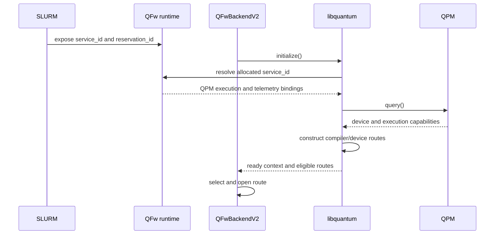

# Design Amendment 01: SDK Integration and QPM-Driven Discovery

**Status:** draft

## Purpose

This amendment defines how established SDKs use libquantum without exposing
libquantum concepts to SDK applications. It also makes the QPM `query()`
response the authoritative source for device identity and route-critical
execution capabilities.

The amendment changes the roles described by the detailed design. An
application is the component that calls libquantum directly. For an established
SDK, that component is its QFw adapter. A program written against Qiskit or
PennyLane continues to use the SDK's ordinary interfaces.

The direct libquantum API remains available for new SDKs, native applications,
workflow engines, qualification tools, and integrations that need explicit
route control.

## Architectural Decision

The QFw adapter for an SDK is a libquantum client. It owns route choice and
translates between the SDK contract and the libquantum contract.

```text
Qiskit application
    -> Estimator, Sampler, or another Qiskit algorithm
    -> QFwBackendV2
    -> libquantum
    -> QRI/QPM
    -> managed device
```

The Qiskit application creates an ordinary backend. It does not construct a
libquantum context, inspect routes, open a route, create a completion queue, or
handle a libquantum operation identifier.

```python
backend = QFwBackendV2()
estimator = BackendEstimatorV2(backend=backend)
result = estimator.run(pubs).result()
```

`QFwBackendV2` initializes libquantum and uses its direct APIs internally. The
backend performs the route query, applies backend-owned policy, opens the
route, compiles programs, submits them, and translates their results.

The existing `QFwBackend` remains available with its current implementation.
This amendment adds a new backend rather than replacing or modifying the
legacy execution path.

The same boundary applies to PennyLane. A QFw PennyLane device calls
libquantum from its preprocessing and execution methods. PennyLane programs
continue to use QNodes, measurements, batching, and framework-managed
derivatives.

## Caller Roles

The term `application` in the libquantum API means the direct caller. It may be
one of the following components.

- `QFwBackendV2` for Qiskit.
- A QFw `Device` implementation for PennyLane.
- A future SDK adapter.
- A native application using libquantum directly.
- A workflow engine or graph executor.

Route choice remains outside libquantum. An SDK adapter satisfies this rule by
acting as the application and selecting a route internally. The SDK user does
not participate in that selection unless the SDK exposes an SDK-native policy
or configuration option.

## Allocation-Scoped QPM Discovery

SLURM and QFw establish the execution allocation before the SDK adapter starts.
The active QFw runtime exposes the allocated QPM service and its reservation
binding. The existing `QFW_RESERVATIONS` value supplies the exact
`[service_id, reservation_id]` pairs available to the process.

libquantum uses each `service_id` only to resolve the allocated QPM binding.
It then calls that QPM's `query()` method to discover the device. Neither the
SDK application nor the adapter supplies a device type, provider name, device
identifier, input format, or QPM implementation selector.

No environment variable such as `QFW_DEVICE_TYPE=IQM` participates in device
discovery. Environment state bootstraps the allocated service and reservation.
The QPM describes the device behind that service.

The normal single-device sequence is:



Initialization fails when an advertised service cannot be resolved, its query
response is invalid, or no compatible route can be constructed. Diagnostics
identify the service, missing field, unsupported schema version, or rejected
capability intersection.

The default `QFwBackendV2()` path requires one executable allocated QPM. A
future provider interface may expose one backend for each allocated QPM when
an allocation contains several devices. It must preserve the same query-driven
discovery and must not ask the SDK application to provide a libquantum route.

## Authoritative QPM Query Contract

`QPM.query()` is the discovery operation for route-critical device facts. QFw
extends its existing service properties rather than adding a parallel device
selection mechanism.

The return type remains `DEFwServiceInfo`. The existing service identity,
provider, QPM type, QPM capability, selector, API binding, and controller
properties retain their current meaning. QFw adds `program_inputs` to the
existing `DEFwServiceInfo.properties` mapping.

An IQM response has this conceptual properties mapping. Numeric type and
capability values use the existing `QPMType` and `QPMCapability` flags.

```json
{
  "provider": "iqm",
  "num_qubits": 20,
  "device_id": "iqm-q20",
  "service_type": "qfw.qpm",
  "service_id": "qpm:iqm:iqm-q20",
  "qpm_type": 1,
  "qpm_capabilities": 4,
  "hardware": true,
  "simulator": false,
  "program_inputs": [
    {
      "representation": "openqasm",
      "versions": ["2.0"],
      "preference": 1,
      "native": false
    },
    {
      "representation": "iqm.pulla",
      "versions": ["1"],
      "preference": 0,
      "native": true
    }
  ]
}
```

The example omits existing selector, API binding, service implementation, and
controller properties for brevity. It does not define a replacement query
object or wire format.

### Service identity

`service_id` is the exact identifier used by the allocation's reservation
binding. libquantum rejects a query response whose service identity conflicts
with the resolved service.

`provider` identifies the provider integration. It is descriptive route and
diagnostic metadata. It is not an application-supplied selector in the normal
managed path.

### Device identity and hardware type

`device_id` is stable within the QFw deployment and identifies the managed
execution target. `qpm_type` and the derived `hardware` and `simulator`
properties distinguish physical execution from simulation.

`qpm_capabilities` describes the hardware or simulator technology. IQM uses
the existing `QPM_CAP_SUPERCONDUCTING` flag. QFw extends `QPMCapability` when a
new technology cannot be represented by the existing flags. libquantum
normalizes these flags into its device model without introducing a duplicate
hardware-type field in the QPM response.

`num_qubits` describes the physical device capacity reported during service
discovery. libquantum obtains allocation- or reservation-scoped usable
capacity from the existing capacity telemetry API.

### Accepted program inputs

`program_inputs` is the authoritative list of representations and versions
accepted by the QPM execution path. Each entry contains:

- `representation`, an extensible lowercase identifier shared with compiler
  output capabilities;
- `versions`, the exact accepted format or contract versions;
- `preference`, a stable nonnegative rank where zero is most preferred; and
- `native`, indicating whether the provider path consumes the representation
  without a representation-conversion stage.

Every advertised representation and version must be accepted by QPM
submission. A generic fallback value is not advertised as supported unless the
path actually accepts it. An empty or invalid input list prevents construction
of compiled routes for that device.

This amendment folds the proposed `get_program_input_capabilities()` operation
into `query()`. A second RPC would duplicate route-critical service metadata
and could disagree with the service record used for discovery.

### Detailed telemetry

The QPM API continues to expose its required telemetry methods. libquantum
calls those methods directly. A QPM returns its defined unavailable, empty, or
null result when the underlying device cannot provide particular data.

The query response does not duplicate method availability. Detailed topology,
calibration, dynamic device data, and usable capacity remain in their existing
telemetry calls.

## libquantum Initialization

libquantum initialization performs these steps for every allocated QPM.

1. Parse and validate the allocation's service and reservation pairs.
2. Resolve each exact QPM service through the active QFw runtime.
3. Bind the QPM execution and telemetry APIs.
4. Call `query()` and validate its service identity and required properties.
5. Normalize the device identity, QPM type, capabilities, and program inputs.
6. Call the required detailed telemetry operations.
7. Load compiler registrations and their input and output capabilities.
8. Match compiler outputs against QPM program inputs by representation and
   version.
9. Build the allocation-scoped route set and compatibility generation.

libquantum does not infer a device type from a service module name, backend
class, environment variable, or provider-specific import. Provider-specific
telemetry normalization remains in the QFw integration that owns that data.

Refresh repeats the query and detailed telemetry calls. libquantum derives its
resource generation from the normalized responses. A changed generation
produces a new resource snapshot and route set. Existing opened routes and
submitted operations retain their original bindings.

## New Qiskit Backend Integration

`QFwBackendV2` is the new Qiskit adapter over libquantum. Its managed
initialization does not require `betype`, provider, device type, or a manually
selected route. The existing `QFwBackend` keeps its current constructor and
execution behavior. The V2 name follows the Qiskit interface convention while
keeping the backend's internal use of libquantum out of the application API.

### Backend ownership and initialization

Each backend owns one libquantum context and one opened route. Jobs own their
completion queues so concurrent jobs cannot consume each other's events. The
backend closes its context only after its jobs have released their queues.

The public managed constructor takes Qiskit configuration only. Private test
factories may inject a context or dummy integration, but libquantum objects are
not public constructor arguments.

```python
class QFwBackendV2(BackendV2):
    def __init__(self, *, route_policy=None, finalize_timeout=300):
        self._context = libquantum.initialize()
        self._route = self._open_qiskit_route(route_policy)
        self._target = self._build_target(self._route)
        self._finalize_timeout = finalize_timeout
        self._closed = False
```

Initialization performs this internal sequence:

```python
context = libquantum.initialize()
routes = context.list_routes()
selected = select_qiskit_route(routes)
route = context.open_route(selected)
```

`select_qiskit_route()` belongs to `QFwBackendV2`. It considers only routes
that accept the Qiskit program representation and can produce a QPM-advertised
input representation. The backend uses a deterministic deployment policy.
When the policy cannot distinguish multiple eligible routes, initialization
or submission reports an ambiguity instead of allowing libquantum to choose.

Route policy is adapter configuration. It may name an enabled compiler or an
ordered compiler preference supplied by the deployment. It never supplies a
device type because the allocation and QPM query determine the device.

An initialization failure finalizes the partially created context before it is
reported as a Qiskit backend initialization error. The diagnostic retains the
QPM service identity and route rejection reasons without exposing credentials
or remote objects.

### Qiskit target construction

The backend constructs its Qiskit `Target` from the selected device telemetry
and compiler route. Qiskit sees the operations, connectivity, capacity, and
other target properties supported by that route.

Target construction maps:

- usable qubit capacity to `Target.num_qubits`;
- normalized operations to Qiskit instruction entries;
- the coupling graph to instruction connectivity;
- timing and calibration data when the QPM supplies them; and
- route and compiler constraints that affect valid Qiskit circuits.

The target describes the opened route, not every theoretical operation of the
physical device. Unsupported or unavailable telemetry produces an honest
partial target using Qiskit's existing optional fields. The adapter does not
invent calibration values or connectivity.

### Backend execution

`run()` accepts one `QuantumCircuit` or a sequence of circuits and validates
Qiskit run options before remote submission. It creates a
`QFwJobV2`, calls its submission method, and returns the job after every
accepted operation has been recorded.

```python
def run(self, circuits, **run_options):
    self._require_open()
    batch = _normalize_circuit_batch(circuits)
    options = _qiskit_execution_options(run_options)
    job = QFwJobV2(self, batch, options)
    job.submit()
    return job
```

Qiskit options are divided by ownership. Shot count and runtime controls become
libquantum execution options. Circuit or compiler controls become compiler
inputs only when the opened compiler contract supports them. Unknown options
produce a Qiskit validation error instead of being silently ignored.

### Qiskit job ownership

`QFwJobV2` owns one completion queue registered for its route. It has one local
Qiskit job identifier because Qiskit requires that identifier. The identifier
groups the job's operations and is not stored in libquantum or sent to QPM.
The existing `QFwJob` remains part of the legacy backend.

The job retains an ordered record for every circuit:

```python
@dataclass
class _ExperimentOperation:
    index: int
    circuit: QuantumCircuit
    op_id: str | None = None
    completion: Completion | None = None
    submission_error: Exception | None = None
```

Before submitting any circuit, the job imports and compiles the complete batch.
This prevents a local compilation failure in a later experiment from leaving
earlier experiments running remotely.

```python
def submit(self):
    compiled = []
    for circuit in self._circuits:
        program = self._context.import_program(circuit)
        compiled.append(self._context.compile(self._route, program))

    self._queue = self._context.create_completion_queue(self._route)
    for index, executable in enumerate(compiled):
        try:
            op_id = self._context.run(
                self._route,
                executable,
                self._queue,
                self._execution_options,
            )
            self._experiments[index].op_id = op_id
        except Exception as error:
            self._experiments[index].submission_error = error
            self._submission_failed = True
            break
```

An immediate failure after earlier circuits were accepted does not discard
their operation identifiers and does not cancel them implicitly. The job
remains responsible for those operations. `result()` can drain their terminal
completions, while `cancel()` explicitly requests cancellation.

A Qiskit job may therefore contain several libquantum operations. Their
`op_id` values remain private implementation state and are included only in
diagnostic metadata intended for operators.

### Status and cancellation

`status()` queries every accepted, nonterminal operation through
`Context.status(op_id)` and maps the aggregate into `JobStatus`.

| Underlying condition | Qiskit status |
| --- | --- |
| Submission or compilation has not started | `INITIALIZING` |
| At least one operation is running | `RUNNING` |
| Operations are accepted but none is running | `QUEUED` |
| Every operation completed successfully | `DONE` |
| Every accepted operation is confirmed cancelled | `CANCELLED` |
| Submission failed or terminal outcomes are mixed or failed | `ERROR` |

The adapter treats unknown QPM status values as nonterminal unless QPM marks
them terminal. It records the original mapping for diagnostics.

`cancel()` calls `Context.cancel(op_id)` for every accepted operation that is
not known to be terminal. A successful request means that all applicable QPMs
accepted the requests. The job reports `CANCELLED` only after terminal
cancellation is confirmed. Unsupported, rejected, or uncertain cancellation
produces `False` and remains visible in job diagnostics.

### Result collection

`result(timeout)` waits on the job's completion queue and correlates events by
the exact `op_id` returned for each circuit. Completion order may differ from
circuit order. The final Qiskit result preserves the original experiment
order.

```python
while unfinished and not deadline.expired():
    if not queue.wait(timeout=deadline.remaining()):
        break
    for completion in queue.get():
        experiment = experiments_by_op_id[completion.op_id]
        experiment.completion = completion
        unfinished.remove(completion.op_id)
```

The adapter converts successful QRI payloads into Qiskit counts, memory,
statevector, experiment metadata, and `Result` containers. It validates result
shape, bit ordering, shot count, and experiment identity. A failed completion
becomes a failed Qiskit experiment with the libquantum error translated into a
safe message.

Timeout of `result()` does not change the underlying operations. It raises the
Qiskit timeout error and retains the queue and operation records so the caller
may wait, inspect status, or cancel afterward.

Once every operation is terminal and its result has been consumed, the job
closes its completion queue. Repeated `result()` calls return the cached Qiskit
result and do not read QPM again.

### Backend shutdown

`shutdown()` rejects new jobs, waits for tracked work through
`libquantum.finalize()`, and reports outstanding QRI operation identifiers if
the configured timeout expires. It does not cancel work implicitly. Repeated
shutdown is safe.

```text
Qiskit job status  <- aggregate context.status(op_id)
Qiskit cancel      -> context.cancel(op_id) for unfinished operations
Qiskit result      <- completion queue results converted to Qiskit objects
```

Result conversion belongs to `QFwBackendV2`. libquantum continues to preserve
successful QRI payloads unchanged.

## PennyLane Integration

A QFw PennyLane device follows the same discovery and route-binding process.
It exposes no provider, device, route, queue, or operation identifier in the
normal QNode interface.

### Device ownership and initialization

The device owns one libquantum context and one opened route. The managed
constructor accepts PennyLane configuration such as wires, shots, and execution
timeout. It does not accept a QPM or hardware type.

```python
class QFwDevice(Device):
    name = "qfw"

    def __init__(self, wires=None, shots=None, *, execution_timeout=300):
        super().__init__(wires=wires, shots=shots)
        self._context = libquantum.initialize()
        self._route = self._open_pennylane_route()
        self._execution_timeout = execution_timeout
        self._active_operations = set()
        self._closed = False
```

Route selection retains only routes that accept the registered PennyLane
program representation and produce an input accepted by the allocated QPM.
The device applies its deterministic deployment policy and reports ambiguity
instead of asking libquantum to choose.

### Preprocessing

`setup_execution_config()` and `preprocess_transforms()` define how PennyLane
interacts with the device. The initial implementation sets
`use_device_gradient=False`, `use_device_jacobian_product=False`, and
`convert_to_numpy=True`.

The preprocessing pipeline uses PennyLane transforms to:

- validate wires, shots, measurements, and execution options;
- decompose operations to the selected route's supported operation set;
- split noncommuting measurements when required;
- expand broadcast parameters when the route cannot consume them directly;
  and
- retain the postprocessing function that reconstructs the requested
  PennyLane result.

The pipeline returns only tapes accepted by the selected compiler integration.
Unsupported operations or measurement types fail during preprocessing before
remote work is submitted.

### Batch execution

`execute()` is synchronous because PennyLane expects numerical results. It
normalizes a single script or script batch, compiles every processed script,
creates one batch-scoped completion queue, submits all compiled programs, and
waits for their terminal completions.

```python
@dataclass
class _BatchExecution:
    queue: CompletionQueue
    op_ids: list[str] = field(default_factory=list)
    terminal: bool = False


def execute(self, circuits, execution_config=None):
    batch, single = _normalize_script_batch(circuits)

    compiled = []
    for script in batch:
        program = self._context.import_program(script)
        compiled.append(self._context.compile(self._route, program))

    execution = _BatchExecution(
        queue=self._context.create_completion_queue(self._route),
    )
    operations = []
    try:
        for executable in compiled:
            op_id = self._context.run(
                self._route,
                executable,
                execution.queue,
                _execution_options(execution_config),
            )
            operations.append(op_id)
            execution.op_ids.append(op_id)
            self._active_operations.add(op_id)

        completions = self._wait_for_batch(execution.queue, operations)
        execution.terminal = True
        results = self._pennylane_results(batch, operations, completions)
        return results[0] if single else tuple(results)
    finally:
        if execution.terminal or not execution.op_ids:
            execution.queue.close()
        else:
            self._pending_batches.append(execution)
```

Compilation of the whole batch precedes submission. An immediate submission
failure retains every accepted `op_id`. The device waits for accepted work up
to its execution timeout before raising `DeviceError`; outstanding operations
remain tracked by the context and are reported during close.

A terminal batch closes its completion queue immediately. A timed-out or
partially submitted batch retains its queue in `_pending_batches` so later
completion, explicit cancellation, or device close can finish cleanup without
losing events. `close()` releases each retained queue after finalization.

Completion events are correlated by `op_id`, while returned values retain the
original tape order. Independent tapes may run concurrently.

### PennyLane result conversion

The device converts each QRI payload according to the processed tape's
measurements. The initial adapter supports only the result forms qualified by
its selected route, such as samples, counts, probabilities, and expectation
values. It validates wire order, shot partitions, result shape, and numeric
type before returning a value.

The preprocessing postprocessing function reconstructs results for split
measurements, broadcast expansion, and other PennyLane transforms. libquantum
does not perform this reconstruction.

### Differentiation

The initial device relies on PennyLane's framework-level differentiation. It
does not advertise native derivatives, JVPs, or VJPs unless an execution route
implements those contracts. Parameter-shift and other framework transforms
may create several libquantum operations, which remain private to the device
adapter.

The device does not implement `compute_derivatives()`, `compute_jvp()`, or
`compute_vjp()` in the initial integration. PennyLane generates the required
script batches and calls `execute()` for them. Device-native derivative methods
may be added only with a route contract that defines their inputs and results.

### Cancellation, tracking, and close

PennyLane's synchronous `execute()` API does not return a job handle. The
device therefore tracks active operation identifiers internally. An optional
device-specific `cancel_pending()` method requests cancellation for every
unfinished execution without exposing those identifiers to the QNode.

The PennyLane tracker records batches, executions, shots, failures, and a safe
aggregate operation count. Raw operation identifiers are retained for
diagnostics but are not ordinary QNode results.

`close()` rejects new execution, waits through `libquantum.finalize()` using
the device timeout, and reports outstanding operations. It does not cancel them
implicitly. The device supports explicit context-manager cleanup, and repeated
close is safe.

## Dependency Direction

The dependency direction is fixed.

```text
QFw SDK adapters -> libquantum -> QRI/QPM interfaces
```

libquantum does not import `QFwBackend`, `QFwBackendV2`, or another SDK
adapter. Reusable QFw service resolution, telemetry normalization, payload,
and target-building helpers live below the adapter layer when libquantum and
an adapter both need them.

This boundary prevents a cycle in which the backend calls libquantum while
libquantum calls backend implementation code.

## Coexistence and Migration

The existing `QFwBackend` and the new `QFwBackendV2` are separate public
classes. Both are packaged and testable in the same QFw installation. Adding
the new backend does not change imports, constructors, provider lookup, or
execution behavior for the existing backend.

The initial implementation uses explicit construction:

```python
from qfw_qiskit import QFwBackend
from qfw_qiskit import QFwBackendV2

legacy_backend = QFwBackend(...)
v2_backend = QFwBackendV2()
```

Provider registration, entry points, configuration names, and documentation
use distinct identifiers. There is no automatic fallback between backends. A
failure in `QFwBackendV2` is reported to its caller rather than retried through
`QFwBackend`.

Shared Qiskit-only helpers may be extracted for target and result conversion
when both backends implement the same observable behavior. The existing
backend does not import libquantum as part of this amendment, and refactoring
must preserve its tests and runtime behavior.

The PennyLane adapter is introduced as `QFwDevice` with the plugin name `qfw`.
No V2 suffix is needed because QFw has no existing PennyLane device to preserve.
Applications select it through ordinary PennyLane device construction.

Migration or retirement of the legacy backend requires a separate design and
qualification decision after the new backend has demonstrated equivalent
required behavior.

The existing direct libquantum API remains unchanged. Direct callers continue
to query eligible routes and choose one explicitly. SDK adapters hide those
objects because they are the direct libquantum callers.

Requirements that prohibit SDK backend submission must be revised. The
required behavior is that provider execution passes through libquantum and QRI.
An SDK adapter implemented by QFw is an approved libquantum caller, not a
provider-native bypass.

## Required QFw Changes

- Add accepted program inputs to the existing `DEFwServiceInfo.properties`
  returned by QPM `query()`.
- Require QPM type, capability, device identity, and capacity properties needed
  for normalized device discovery.
- Populate the fields from the actual execution path for every supported QPM.
- Ensure the allocation-scoped runtime resolves the exact service identifiers
  supplied with reservations.
- Reject advertisements for formats the QPM cannot submit.
- Provide contract tests that submit every advertised input representation.

## Required libquantum Changes

- Treat `QPM.query()` as the authoritative route-discovery response.
- Replace the proposed separate input-capability RPC with query normalization.
- Normalize existing QPM type and capability flags into the device model.
- Construct routes from compiler outputs and QPM-advertised program inputs.
- Expose enough normalized telemetry for SDK adapters to construct SDK targets.
- Keep route selection explicit for direct callers while allowing adapters to
  own their route policy.

## Required New Backend Changes

- Add `QFwBackendV2` without changing `QFwBackend` behavior.
- Add `QFwJobV2` without changing `QFwJob` behavior.
- Initialize libquantum without an application-supplied backend type.
- Select and open a compatible route internally.
- Build the Qiskit target from discovered device and route information.
- Implement Qiskit jobs over one or more libquantum operation identifiers.
- Delegate status and cancellation to libquantum.
- Convert QRI completions into Qiskit result objects.

## Required New PennyLane Device Changes

- Add and register `QFwDevice` as `qfw`.
- Build preprocessing from the selected route's supported operations and
  measurements.
- Compile whole batches before submitting them through libquantum.
- Correlate out-of-order completions and restore PennyLane tape order.
- Convert QRI payloads into the qualified PennyLane measurement forms.
- Use framework-level differentiation until a route provides derivative
  contracts.
- Track pending batches for explicit cancellation and safe close behavior.

## Validation

The amendment is complete when the following cases pass.

1. An allocation containing one IQM QPM supports
   `QFwBackendV2()` without a device-type argument.
2. Initialization obtains IQM identity, hardware capability, and accepted
   formats through `QPM.query()` and usable capacity through QPM telemetry.
3. libquantum constructs only compiler routes whose output representation and
   version match the QPM advertisement.
4. `BackendEstimatorV2(QFwBackendV2())` executes without exposing
   libquantum objects to the Qiskit application.
5. Qiskit job status, cancellation, and results map to the underlying
   libquantum operations.
6. A malformed or contradictory QPM query response fails initialization with
   a service-specific diagnostic.
7. A QPM that advertises an input format accepts a qualification payload in
   that format.
8. No managed execution path requires an application-supplied provider,
   hardware type, device identifier, or libquantum route.
9. The existing `QFwBackend` passes its unchanged regression suite and can run
   in the same installation as `QFwBackendV2`.
10. `QFwDevice` is registered as `qfw` without replacing another PennyLane
    device entry point.
