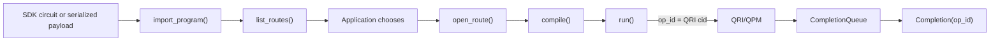

# Detailed Design

**Status:** draft

## Purpose

**Requirements:** [LQ-INT-001](requirements.md#lq-int-001), [LQ-APP-001](requirements.md#lq-app-001), [LQ-CON-003](requirements.md#lq-con-003), [LQ-ENV-001](requirements.md#lq-env-001), [LQ-PRG-008](requirements.md#lq-prg-008)

> **Prototype language:** This document specifies the Python prototype. Python classes, data classes, protocols, enums, and type annotations express the intended contracts. The final public design and implementation will be in C; its types, ownership rules, function signatures, and ABI will be defined separately from this prototype.

This design describes the SC26 library boundary and the flow from application program input to managed QPM execution and result delivery. The application owns algorithmic control flow, parameter updates, data binding, and final route choice. libquantum owns route discovery and filtering, route-instance creation, compiler binding, QRI submission, and registration of application completion queues with QRI. Graph construction and execution are future convenience layers over these APIs. The design maps to the observable behavior in `docs/requirements.md`; upstream proposals and the Backline prototype are not treated as available execution functionality.

**Status:** draft

## Application Workflow

**Requirements:** [LQ-INT-001](requirements.md#lq-int-001), [LQ-INT-002](requirements.md#lq-int-002), [LQ-INT-003](requirements.md#lq-int-003), [LQ-APP-001](requirements.md#lq-app-001), [LQ-APP-002](requirements.md#lq-app-002), [LQ-COMP-009](requirements.md#lq-comp-009), [LQ-DEMOINT-004](requirements.md#lq-demoint-004), [LQ-DEMOINT-005](requirements.md#lq-demoint-005)

This example is the reference application flow for the Python prototype. Route choice, compilation, and submission are separate application operations. The final C API preserves the same flow with C handles, callbacks, return codes, and ownership functions.

```python
from qiskit import QuantumCircuit

from libquantum import ExecutionOptions, finalize, initialize


context = initialize()
completion_queue = None

try:
    circuit = QuantumCircuit(4)
    circuit.h(0)
    circuit.cx(0, 1)
    circuit.measure_all()

    program = context.import_program(circuit)
    route_query = context.list_routes(program, explain=True)
    if not route_query.routes:
        raise RuntimeError("no eligible route")

    # The application owns route choice.
    route = context.open_route(route_query.routes[0])
    completion_queue = context.create_completion_queue(route)

    # Compilation is independent of submission.
    compiled = context.compile(route, program)

    pending = {}
    for iteration in range(3):
        op_id = context.run(
            route,
            compiled,
            completion_queue,
            execution_options=ExecutionOptions(shots=1000),
        )
        pending[op_id] = {"iteration": iteration}

    for op_id in pending:
        current = context.status(op_id)

    while pending:
        if not completion_queue.wait(timeout=300):
            raise TimeoutError(f"{len(pending)} operations remain incomplete")

        for completion in completion_queue.get():
            application_operation = pending.pop(completion.op_id)
            if completion.error is not None:
                application_operation["error"] = completion.error
            else:
                application_operation["qri_completion"] = completion.result
finally:
    if completion_queue is not None:
        completion_queue.close()
    finalized = finalize(context, timeout=300)
```

`import_program()` identifies the SDK object. `list_routes()` returns every eligible `AvailableRoute`; libquantum does not rank or choose among them. The application chooses one and `open_route()` binds its compiler state, device access, negotiated format, and QRI path. `compile()` invokes only the bound compiler integration and does not submit. `run()` accepts the compiler result, submits it through the bound QRI/QPM path, extracts QRI `cid`, tracks that value internally, and returns it as `op_id`.

`status(op_id)` calls the owning QPM's `task_status`. `cancel(op_id)` calls its `cancel_task`. QRI/QPM pushes the terminal event into the selected endpoint. `CompletionQueue.get()` exposes the same `cid` as `Completion.op_id` and marks the internally tracked operation complete.



Application code owns route choice, operation ordering, and result interpretation. libquantum owns the QRI operation-to-route/queue mapping needed for status, cancellation, completion, and finalization.

**Status:** draft

## Application API

**Requirements:** [LQ-INT-002](requirements.md#lq-int-002), [LQ-INT-003](requirements.md#lq-int-003), [LQ-PRG-001](requirements.md#lq-prg-001), [LQ-PRG-002](requirements.md#lq-prg-002), [LQ-COMP-007](requirements.md#lq-comp-007), [LQ-TASK-001](requirements.md#lq-task-001), [LQ-TASK-002](requirements.md#lq-task-002), [LQ-TASK-003](requirements.md#lq-task-003), [LQ-TASK-004](requirements.md#lq-task-004), [LQ-APP-001](requirements.md#lq-app-001), [LQ-APP-002](requirements.md#lq-app-002)

The public Python API has lifecycle functions, a stateful `Context`, selected `ProgramRoute` handles, and QRI-backed completion queues. Handles created by one context cannot be mixed with another context. The application explicitly imports a program, queries and chooses a route, compiles when required, and submits the compiler result.

```python
def initialize(config: InitConfig | None = None) -> Context: ...

def finalize(
    context: Context,
    timeout: float | None = None,
) -> FinalizeResult: ...


class Context:
    @property
    def context_id(self) -> str: ...

    def refresh_resources(self) -> ResourceSnapshot: ...
    def list_compilers(self) -> tuple[Compiler, ...]: ...
    def list_devices(self) -> tuple[Device, ...]: ...

    def import_program(
        self,
        payload: object | bytes | str,
        *,
        representation: Representation | None = None,
        requirements: ProgramRequirements | None = None,
    ) -> Program: ...

    def import_opaque(
        self,
        payload: object | bytes | str,
        *,
        requirements: ProgramRequirements | None = None,
    ) -> Program: ...

    def list_routes(
        self,
        program: Program | None = None,
        constraints: RouteConstraints | None = None,
        explain: bool = False,
    ) -> RouteQueryResult: ...

    def open_route(self, route: AvailableRoute) -> ProgramRoute: ...

    def create_completion_queue(
        self,
        route: ProgramRoute,
    ) -> CompletionQueue: ...

    def compile(
        self,
        route: ProgramRoute,
        program: Program,
    ) -> CompilerResult: ...

    def run(
        self,
        route: ProgramRoute,
        executable: CompilerResult | Program,
        completion_queue: CompletionQueue,
        execution_options: ExecutionOptions | None = None,
    ) -> str: ...  # QRI cid, exposed as op_id.

    def status(self, op_id: str) -> Mapping[str, object]: ...

    def cancel(self, op_id: str) -> Mapping[str, object]: ...
```

`import_program()` recognizes and validates; it does not compile, serialize, copy, or submit. Unknown or ambiguous input fails. `import_opaque()` is the only implicit-free opaque path.

`list_routes()` filters the cached map and returns every eligible route in deterministic `route_id` order. It does not rank or choose. The application passes one definition to `open_route()`, which creates a fresh instance with fixed compiler and QRI bindings.

`compile()` is synchronous and independent of submission. `run()` performs no route selection or compilation. It accepts a `CompilerResult` for a compiled route, or an explicitly opaque `Program` for an opaque route, and returns only the QRI `cid` as `op_id`. The context privately tracks the operation's route, queue, QPM, reservation, and terminal state.

`status()` and `cancel()` require a currently tracked operation ID and dispatch to `task_status` and `cancel_task` on that operation's bound QPM. Graph APIs, automatic route selection, compiler configuration, result processing, and circuit cutting remain future scope.

**Status:** draft

## Shared Data Model

**Requirements:** [LQ-INT-003](requirements.md#lq-int-003), [LQ-CON-006](requirements.md#lq-con-006)

Every named contract uses one of the following Python forms. The declaration is shown in the same design section that defines its fields and behavior.

- `@dataclass(frozen=True)` is an immutable value record.
- `Enum` is a closed set of states or modes.
- `Protocol` is an interface implemented by an integration.
- A regular `class` is a stateful library-owned handle.
- An `Exception` subclass is raised by synchronous APIs; its structured detail remains an immutable record.
- Standard containers such as `tuple`, `frozenset`, and `Mapping` are containers rather than new libquantum structures.

Common records used by several contracts are declared here.

```python
@dataclass(frozen=True)
class VersionSet:
    """Exact versions reported by a compiler or device capability."""

    values: tuple[str, ...]


@dataclass(frozen=True)
class Diagnostic:
    code: str
    message: str
    severity: Literal["info", "warning", "error"]
    details: Mapping[str, object] = field(default_factory=dict)

```

Public records are immutable. Handles contain context identity and opaque local identifiers; callers do not construct them. Compiler, device, format, and other symbolic identifiers are lowercase namespaced strings. SDK-object representation identities are derived dynamically from the registered Python type as `python:<module>.<qualname>` and preserve the type's case. Version fields describe the represented contract or implementation. libquantum uses only explicitly reported values and does not infer ranges or adjacent-version support.

**Status:** draft

### Program Representation

**Requirements:** [LQ-PRG-001](requirements.md#lq-prg-001), [LQ-PRG-002](requirements.md#lq-prg-002), [LQ-PRG-003](requirements.md#lq-prg-003), [LQ-PRG-004](requirements.md#lq-prg-004), [LQ-PRG-005](requirements.md#lq-prg-005), [LQ-PRG-007](requirements.md#lq-prg-007), [LQ-PRG-008](requirements.md#lq-prg-008)

`Program` is an immutable value record returned by `Context.import_program()` or `Context.import_opaque()`. It preserves the caller's original object or payload and records how the configured compiler integrations identify it. It contains no compiler or execution destination; those decisions belong to `ProgramRoute`. Applications do not construct `Program` directly.

```python
class ProgramKind(str, Enum):
    SDK_OBJECT = "sdk_object"
    SERIALIZED = "serialized"
    OPAQUE = "opaque"


@dataclass(frozen=True)
class Representation:
    kind: ProgramKind
    name: str
    version: str | None
    sdk: str | None
    sdk_version: str | None
    object_type: str | None


@dataclass(frozen=True)
class ProgramRequirements:
    logical_qubits: int | None = None
    required_features: frozenset[str] = frozenset()
    workload_kind: str = "quantum"


@dataclass(frozen=True)
class Program:
    payload: object | bytes | str
    representation: Representation
    requirements: ProgramRequirements = ProgramRequirements()
```

`ProgramKind` classifies the three broad input forms; it does not enumerate SDKs, circuit classes, or serialized formats. Those identities are contributed dynamically by compiler registrations.

The normal application call supplies only the SDK object:

```python
circuit = QuantumCircuit(...)
program = context.import_program(circuit)
route_query = context.list_routes(program)
route = context.open_route(route_query.routes[0])  # Application choice.
completion_queue = context.create_completion_queue(route)
compiled = context.compile(route, program)
op_id = context.run(route, compiled, completion_queue)
```

`import_program()` constructs the `Program` as follows:

```python
def import_program(
    self,
    payload: object | bytes | str,
    *,
    representation: Representation | None = None,
    requirements: ProgramRequirements | None = None,
) -> Program:
    self._require_active()

    if representation is not None:
        identified = self._representations.validate_explicit(
            payload, representation
        )
    else:
        identified = self._representations.identify_object(payload)

        if identified is None:
            matches = tuple(
                match
                for recognizer in self._representations.serialized_recognizers
                if (match := recognizer.identify(payload)) is not None
            )
            identified = self._require_one_representation(matches)

    return Program(
        payload=payload,
        representation=identified,
        requirements=requirements or ProgramRequirements(),
    )
```

An unrecognized or conflicting input does not fall back to opaque forwarding. `_require_one_representation()` raises `UNKNOWN_REPRESENTATION` for no matches and `AMBIGUOUS_REPRESENTATION` for conflicting matches.

Opaque forwarding is an explicit application choice with a concise factory:

```python
def import_opaque(
    self,
    payload: object | bytes | str,
    *,
    requirements: ProgramRequirements | None = None,
) -> Program:
    self._require_active()

    return Program(
        payload=payload,
        representation=Representation(
            kind=ProgramKind.OPAQUE,
            name="opaque",
            version=None,
            sdk=None,
            sdk_version=None,
            object_type=None,
        ),
        requirements=requirements or ProgramRequirements(),
    )
```

The application call is:

```python
program = context.import_opaque(payload)
```

For an SDK object, initialization has already built `object_types` from all `CompilerRegistration.object_types` entries. Lookup is by exact Python type, but the registry retains every compiler's version support for that type. `identify_object()` obtains the installed SDK version, finds registrations whose `sdk_versions` include it, and constructs one canonical program representation. Given a `QuantumCircuit` from an installed Qiskit 2.5 environment, it produces:

```python
Representation(
    kind=ProgramKind.SDK_OBJECT,
    name="python:qiskit.circuit.QuantumCircuit",
    version="2.5",
    sdk="qiskit",
    sdk_version="2.5",
    object_type="qiskit.circuit.QuantumCircuit",
)
```

For an SDK-object representation, `version` is the concrete installed SDK version used to create the object. The representation name is derived from `python_type.__module__` and `python_type.__qualname__`; libquantum does not define an SDK-type enum or know `QuantumCircuit` before registration. Subclasses match only when a compiler registers the subclass explicitly. Route eligibility then retains only compilers whose registration and matching `InputCapability.versions` accept version 2.5; registrations for version 1.5 remain valid but are not eligible for this program.

For bytes and strings, Python type alone is insufficient. The serialized recognizers contributed by compiler registrations validate signatures such as an OpenQASM declaration or QPY header. Identical matches are deduplicated. No match produces `UNKNOWN_REPRESENTATION`; conflicting matches produce `AMBIGUOUS_REPRESENTATION`. Failed recognition never silently becomes opaque.

The application may supply an explicit recognized representation when automatic identification is impossible or undesirable. Opaque input always requires explicit intent, preferably through `import_opaque()`; passing `Representation(kind=ProgramKind.OPAQUE, name="opaque", ...)` to `import_program()` is equivalent. Caller-supplied requirements are preserved; the selected compiler's `analyze()` callback fills missing selection information and cannot weaken caller constraints.

Parameter bindings, future compilation controls, shot count, and execution destination are operation or route inputs rather than properties of the reusable source program.

**Status:** draft

### Device Representation

**Requirements:** [LQ-DEV-001](requirements.md#lq-dev-001), [LQ-DEV-002](requirements.md#lq-dev-002), [LQ-DEV-003](requirements.md#lq-dev-003), [LQ-DEV-004](requirements.md#lq-dev-004), [LQ-DEMO-003](requirements.md#lq-demo-003)

The public `Device` is an immutable, allocation-scoped snapshot. `DeviceAccessContext` is a separate libquantum-private routing record. It identifies the already-resolved QPM execution and telemetry bindings for one allocated device and carries the reservation and service identifiers required to address those APIs. It is not an authentication or provider-access record, and public APIs and compiler callbacks never receive it.

```python
@dataclass(frozen=True)
class FormatSupport:
    representation: str
    versions: VersionSet
    preference: int              # 0 is the device's highest preference
    native: bool


@dataclass(frozen=True)
class DeviceCapacity:
    physical_qubits: int | None
    usable_qubits: int | None
    capacity_source: str


@dataclass(frozen=True)
class CouplingEdge:
    source: int
    target: int


@dataclass(frozen=True)
class CouplingGraph:
    qubit_count: int
    edges: tuple[CouplingEdge, ...]
    directed: bool


@dataclass(frozen=True)
class Device:
    device_id: str
    display_name: str | None
    provider: str | None
    allocation_id: str
    execution_api_version: str
    accepted_inputs: tuple[FormatSupport, ...]
    capacity: DeviceCapacity
    operations: tuple[str, ...]
    coupling_graph: CouplingGraph | None
    calibration_snapshot_id: str | None
    telemetry_library: str | None       # QRMI/QDMI selector used by the QPM
    metadata_source: str
    metadata_complete: bool
    snapshot_generation: str


@dataclass(frozen=True)
class DeviceAccessContext:
    """Private QFw call path associated with an allocated device."""

    execution_binding: object
    telemetry_binding: object
    reservation_id: str
    qpm_service_id: str
    telemetry_library: str | None
```

`Device` does not expose QPM service or reservation identity. `Context` retains those values only in the internal `DeviceAccessContext` associated with the device. It uses the telemetry binding for unscoped device discovery and binds the execution interface plus reservation identity into each opened route. The allocation and reservation are established before libquantum initialization. QFw authenticates the caller through its RPC transport and QPM resolves provider access from the server-side reservation binding; libquantum does not receive, store, or pass authentication material. `Device.accepted_inputs` is built by mechanically translating the versioned QRI program-input-capability response into `FormatSupport`; `FormatSupport` itself is not a QFw wire type. It is ordered by `preference`; the native device format has the highest preference. The explicit integer is retained so ordering remains stable across serialization and the final C representation. `usable_qubits` is the capacity used for route eligibility. `physical_qubits` is descriptive and cannot substitute for a smaller reservation limit. `metadata_complete=False` prevents a generic fallback from being presented as a fully characterized target. Multiple routes reference the same `device_id` and `snapshot_generation`.

**TODO — QEC and classical resources:** define the QEC codes, decoder/controller/coprocessor capabilities, classical memory/compute constraints, placement data, and versioned schemas needed by Catalyst/Backline routes. Do not add unversioned catch-all fields to `Device`; add typed capability records after the required QRI contracts and selection semantics are known.

**Status:** draft

### Program Route

**Requirements:** [LQ-DEV-004](requirements.md#lq-dev-004), [LQ-COMP-004](requirements.md#lq-comp-004), [LQ-SEL-001](requirements.md#lq-sel-001), [LQ-SEL-002](requirements.md#lq-sel-002), [LQ-SEL-003](requirements.md#lq-sel-003)

`AvailableRoute` and `ProgramRoute` represent different lifetimes. An available route is an immutable compatibility-map definition shared by all callers. A program route is a context-owned instance created by `open_route()` for the exact `AvailableRoute` chosen by the application.

```python
@dataclass(frozen=True)
class AvailableRoute:
    route_id: str
    compatibility_generation: str
    compiler: Compiler | None
    compiler_input: InputCapability | None
    compiler_output: OutputCapability | None
    device: Device
    device_input: FormatSupport | None
    negotiated_output_version: str | None


class ProgramRoute:
    """Selected route handle with bound compiler and QRI dispatch."""

    instance_id: str
    definition: AvailableRoute

    # Private bindings installed by Context.open_route().
    compiler_callbacks: CompilerCallbacks | None
    compiler_state: object | None
    device_access: DeviceAccessContext

    @property
    def route_id(self) -> str: return self.definition.route_id

    @property
    def compatibility_generation(self) -> str:
        return self.definition.compatibility_generation

    @property
    def compiler(self) -> Compiler | None: return self.definition.compiler

    @property
    def compiler_input(self) -> InputCapability | None:
        return self.definition.compiler_input

    @property
    def compiler_output(self) -> OutputCapability | None:
        return self.definition.compiler_output

    @property
    def device(self) -> Device: return self.definition.device

    @property
    def device_input(self) -> FormatSupport | None:
        return self.definition.device_input

    @property
    def negotiated_output_version(self) -> str | None:
        return self.definition.negotiated_output_version
```

The properties let applications use `route.compiler` and `route.device` without dereferencing the definition. Internally, instances reference the shared definition instead of copying compiler and device descriptions.

For a compiled definition, the compiler input and output come from the selected `Compiler`, the device input comes from the selected `Device`, the compiler-output and device-input representations match, and `negotiated_output_version` is one exact version reported by both capabilities. The compiler contract guarantees every advertised input can reach every advertised output.

For an opaque definition, all compiler and format fields are `None`. Its selected instance forwards `Program.payload` unchanged through the device's internal access context.

`route_id` deterministically identifies the shared definition. `instance_id` uniquely identifies one selected instance within the context. Opening the same definition twice produces equal `route_id` values and unequal `instance_id` values.

`open_route()` binds the compiler callbacks, compiler state, and private `DeviceAccessContext` once. `Context.compile(route, program)` and `Context.run(route, ...)` dispatch through those fixed bindings. `compile()` returns the compiler result unchanged. `run()` extracts the QRI response's `cid`, records the operation against this route, and returns that string as `op_id`; libquantum defines no second identifier. Neither `compile()` nor `run()` repeats route lookup or compatibility analysis.

**Future — route-local compiler configuration:** compiler options and pass pipelines are outside SC26. A future selected instance may carry the following configuration. It belongs only to that instance and never mutates the shared definition, compiler representation, or another instance.

```python
@dataclass(frozen=True)
class CompilerConfiguration:
    options: Mapping[str, object] = field(default_factory=dict)
    passes: tuple[str, ...] = ()
    fingerprint: str = ""


# Future ProgramRoute members; not present in SC26.
compiler_configuration: CompilerConfiguration | None

def configure_compiler(
    self,
    options: Mapping[str, object] | None = None,
    passes: tuple[str, ...] = (),
) -> None: ...
```

A future `Context.compile()` snapshots the instance configuration and passes it to the bound compiler callback. It accepts no per-call compilation options. Opening the definition again creates another independently configurable instance.

Resource refresh does not mutate or revalidate an opened route. The route remains bound to the compiler and QRI path established by `open_route()`.

**Status:** draft

### Operation Records

**Requirements:** [LQ-FMT-005](requirements.md#lq-fmt-005), [LQ-OBS-002](requirements.md#lq-obs-002), [LQ-TASK-002](requirements.md#lq-task-002), [LQ-TASK-003](requirements.md#lq-task-003), [LQ-TASK-004](requirements.md#lq-task-004)

The immutable public records define route filters, execution options, and compiler provenance.

```python
@dataclass(frozen=True)
class RouteConstraints:
    route_id: str | None = None
    compiler_id: str | None = None
    device_id: str | None = None
    input_representation: str | None = None
    input_version: str | None = None
    output_representation: str | None = None
    output_version: str | None = None
    minimum_usable_qubits: int | None = None


@dataclass(frozen=True)
class ExecutionOptions:
    shots: int | None = None
    parameter_bindings: Mapping[str, object] = field(default_factory=dict)
    timeout: float | None = None
    values: Mapping[str, object] = field(default_factory=dict)


@dataclass(frozen=True)
class CompilerProvenance:
    compiler_id: str
    compiler_version: str
    source_representation: Representation
    output_representation: Representation
    target_source: str | None
    additional_stages: tuple[str, ...] = ()
```

`RouteConstraints` filters `list_routes()` and does not configure or select a route. `ExecutionOptions` is passed by `Context.run()` to QRI. Compiler options and passes are future route state.

The context also owns one private mutable record per accepted QRI operation:

```python
@dataclass
class _OperationRecord:
    op_id: str                 # Exact QRI cid.
    route: ProgramRoute
    completion_queue: CompletionQueue
    qpm: object
    reservation_id: str
    terminal: bool = False
```

`run()` adds the record only after QRI accepts the operation and returns `cid`. `status()` and `cancel()` look it up by `op_id`. Consuming its terminal completion marks it terminal. The record is internal bookkeeping and is not a second task handle, local lifecycle, correlation object, or result store.

**Status:** draft

## Compiler Integration Contract

**Requirements:** [LQ-CMP-001](requirements.md#lq-cmp-001), [LQ-CMP-002](requirements.md#lq-cmp-002), [LQ-CMP-003](requirements.md#lq-cmp-003), [LQ-CMP-004](requirements.md#lq-cmp-004), [LQ-CMP-005](requirements.md#lq-cmp-005), [LQ-COMP-001](requirements.md#lq-comp-001), [LQ-COMP-002](requirements.md#lq-comp-002), [LQ-COMP-005](requirements.md#lq-comp-005), [LQ-EXT-006](requirements.md#lq-ext-006), [LQ-CON-007](requirements.md#lq-con-007)

Compiler integrations are independently installed plugins discovered from configured directories during `initialize()`. Adding an installed compiler does not require a libquantum source change. Every plugin, registration, compiler-facing structure, and callback is declared in this contract block.

```python
@dataclass(frozen=True)
class CompilerInitContext:
    context_id: str
    configuration: Mapping[str, object]


@dataclass(frozen=True)
class CompilerInfo:
    compiler_id: str
    display_name: str
    version: str
    available: bool
    unavailable_reason: str | None
    supported_features: frozenset[str]
    configuration_fingerprint: str


@dataclass(frozen=True)
class ObjectTypeRegistration:
    python_type: type
    sdk: str
    sdk_versions: VersionSet


class SerializedRepresentationRecognizer(Protocol):
    def identify(
        self,
        value: object | bytes | str,
    ) -> Representation | None: ...


@dataclass(frozen=True)
class RepresentationRegistry:
    """Internal registry assembled from all compiler registrations."""

    fingerprint: str
    object_types: Mapping[type, tuple[ObjectTypeRegistration, ...]]
    serialized_recognizers: tuple[SerializedRepresentationRecognizer, ...]

    def identify_object(self, value: object) -> Representation | None: ...


class InputMode(str, Enum):
    NATIVE = "native"
    CONVERTED = "converted"


@dataclass(frozen=True)
class InputCapability:
    representation: str
    versions: VersionSet
    preference: int              # 0 is the compiler's highest preference
    mode: InputMode
    required_features: frozenset[str] = frozenset()
    target_constraints: Mapping[str, object] = field(default_factory=dict)


@dataclass(frozen=True)
class OutputCapability:
    representation: str
    versions: VersionSet
    preference: int              # 0 is the compiler's highest preference
    native: bool
    serializer_id: str
    target_constraints: Mapping[str, object] = field(default_factory=dict)


@dataclass(frozen=True)
class Compiler:
    """Immutable representation assembled from callback results."""

    info: CompilerInfo
    input_capabilities: tuple[InputCapability, ...]
    output_capabilities: tuple[OutputCapability, ...]


@dataclass(frozen=True)
class ProgramAnalysis:
    logical_qubits: int | None
    required_features: frozenset[str]
    complete_for_route_filtering: bool
    diagnostics: tuple[Diagnostic, ...] = ()


@dataclass(frozen=True)
class CompatibilityRequest:
    program: Program
    analysis: ProgramAnalysis
    device: Device
    output_representation: str
    output_version: str


@dataclass(frozen=True)
class CompatibilityReport:
    compatible: bool
    reason_codes: tuple[str, ...]
    diagnostics: tuple[Diagnostic, ...] = ()
    required_target_data: tuple[str, ...] = ()
    estimates: Mapping[str, float] = field(default_factory=dict)


@dataclass(frozen=True)
class CompilerRequest:
    program: Program
    device: Device
    output_representation: str
    output_version: str


@dataclass(frozen=True)
class CompilerResult:
    payload: object | bytes | str
    representation: Representation
    source_snapshot: object | None
    target_snapshot: object | None
    layout: object | None
    parameter_metadata: Mapping[str, object]
    provenance: CompilerProvenance
    diagnostics: tuple[Diagnostic, ...] = ()


class CompilerCallbacks(Protocol):
    def initialize(self, context: CompilerInitContext) -> object: ...
    def describe(self, state: object) -> CompilerInfo: ...
    def input_capabilities(
        self, state: object
    ) -> tuple[InputCapability, ...]: ...
    def output_capabilities(
        self, state: object
    ) -> tuple[OutputCapability, ...]: ...
    def analyze(
        self, state: object, program: Program
    ) -> ProgramAnalysis: ...
    def check_compatibility(
        self, state: object, request: CompatibilityRequest
    ) -> CompatibilityReport: ...
    def compile(
        self, state: object, request: CompilerRequest
    ) -> CompilerResult: ...
    def finalize(self, state: object) -> None: ...


@dataclass(frozen=True)
class CompilerRegistration:
    compiler_id: str
    callbacks: CompilerCallbacks
    object_types: tuple[ObjectTypeRegistration, ...] = ()
    serialized_recognizers: tuple[
        SerializedRepresentationRecognizer, ...
    ] = ()


@dataclass(frozen=True)
class CompilerPluginManifest:
    """Validated form of one compiler.json file."""

    schema_version: int
    compiler_id: str
    plugin_api_version: int
    module: str
    factory: str


class CompilerPluginFactory(Protocol):
    def __call__(self) -> CompilerRegistration: ...
```

Each installed Python plugin has its own directory and a `compiler.json` manifest beside its implementation. For example:

```text
compilers/
  qiskit/
    compiler.json
    plugin.py
  mqt/
    compiler.json
    plugin.py
```

The manifest is data, not executable registration code. libquantum validates it into `CompilerPluginManifest` before importing the module. A minimal manifest is:

```json
{
  "schema_version": 1,
  "compiler_id": "qiskit",
  "plugin_api_version": 1,
  "module": "plugin",
  "factory": "create_compiler_registration"
}
```

The named factory implements `CompilerPluginFactory` and returns one `CompilerRegistration`. The manifest and returned registration must use the same `compiler_id`. Loading does not depend on module-import side effects or a global registration list. Duplicate compiler identifiers, unsupported manifest or plugin API versions, missing factories, invalid callback objects, and path escapes fail initialization with structured diagnostics.

Discovery searches only the configured compiler directories. `enabled_compilers=None` enables every valid discovered plugin; a set enables only matching identifiers. Unknown enabled identifiers are configuration errors. Search order does not resolve duplicate identifiers, so duplicates fail rather than silently shadowing one another. Compiler directories are deployment-controlled and must not default to the working directory. Plugins are loaded during initialization and remain loaded until their compiler state is finalized. Runtime installation, unloading, or replacement is outside SC26.

The final C implementation keeps the same manifest and lifecycle model. Its loader opens the manifest-selected shared library and resolves a versioned registration symbol such as `lq_compiler_register_v1`; the returned C registration table provides the equivalent callback function pointers and capability queries.

`ObjectTypeRegistration` lets one compiler declare an SDK class and the SDK versions of that class it can ingest. libquantum derives the representation identity as `python:<python_type.__module__>.<python_type.__qualname__>` and verifies that the compiler advertises a matching `InputCapability` covering the registered versions. The registry stores a tuple of registrations for each exact Python type; it does not merge their version sets or require them to be equal. For example, one compiler may register Qiskit `QuantumCircuit` 1.5 and another may register 2.5. Both registrations remain valid, and the application's installed SDK version determines which compiler routes are eligible. A conflict occurs only when registrations assign incompatible SDK identity to the same runtime Python type, not when their supported versions differ. Serialized recognizers are likewise contributed by compilers; their returned representation names and versions must match that compiler's input capabilities. libquantum owns validation and indexing, not the vocabulary of SDK types or formats.

`InputCapability.representation` and `OutputCapability.representation` use the extensible representation identifiers defined by the QRI program-input-capability wire contract. Compiler plugins and QPM providers must use identical identifiers for compatible formats; libquantum performs exact identifier and version-set matching and does not maintain a closed format enum. `InputCapability` and `OutputCapability` preferences are stable nonnegative ranks; lower values are preferred. Native capabilities must rank ahead of converted or non-native capabilities. The integration contract guarantees a full cross-product: every advertised input capability can be compiled into every advertised output capability. An integration that cannot satisfy that invariant must register narrower compiler representations rather than advertise unrelated input and output sets.

`initialize()` may allocate compiler-owned state and is called once per context. libquantum passes the deployment-selected entry from `InitConfig.compiler_configuration` through `CompilerInitContext.configuration`; these are initialization settings, not application compilation options. libquantum calls `describe()`, `input_capabilities()`, and `output_capabilities()`, assembles one immutable `Compiler`, and validates its contributed object types and serialized recognizers against those capabilities. It then builds the context's internal `RepresentationRegistry` from all successful compiler registrations. `Context.list_compilers()` returns these representations. Capability callbacks are queried again only after explicit refresh or configuration change. `check_compatibility()` is called for each candidate definition and actual program. For SC26, `compile()` uses registered/default configuration and performs any integration-owned input conversion and output serialization; the callback result is returned unchanged to the application. `finalize()` must tolerate repeated cleanup after partial initialization.

`CompilerCallbacks` is the compiler dispatch table. `open_route()` binds the selected callback object and initialized state into the route. `Context.compile(route, program)` invokes that bound callback directly and returns `CompilerResult` unchanged. Capability discovery, compatibility analysis, callback lookup, and result verification are not repeated on the opened-route path. Future route-local configuration is snapshotted into the compiler request without mutating shared state.

Control-path callbacks report structured failures during discovery and route query. The bound `compile()` callback returns its compiler-defined result directly. `Context.compile()` translates a callback exception into `LibquantumError` with stage `COMPILATION`. Compiler callbacks receive the normalized allocation-scoped `Device`, not QFw service bindings, reservation identifiers, or authentication state. libquantum collects required target data through its private `DeviceAccessContext` before invoking a callback and records incomplete target data on `Device`. `Context` retains each registration's callback object and initialized state, keyed by `Compiler.info.compiler_id`. `open_route()` binds the selected entries into private `ProgramRoute` state; they are not embedded in the public `Compiler` representation.

**Status:** draft

## Device Discovery Through QRI

**Requirements:** [LQ-RES-001](requirements.md#lq-res-001), [LQ-RES-002](requirements.md#lq-res-002), [LQ-DEV-001](requirements.md#lq-dev-001), [LQ-DEV-002](requirements.md#lq-dev-002), [LQ-COMP-003](requirements.md#lq-comp-003), [LQ-QFW-003](requirements.md#lq-qfw-003), [LQ-ADAPT-004](requirements.md#lq-adapt-004), [LQ-ADAPT-005](requirements.md#lq-adapt-005), [LQ-FMT-002](requirements.md#lq-fmt-002), [LQ-DEMO-007](requirements.md#lq-demo-007)

Discovery begins with the active QFw resolver/directory context and retains only QPM services belonging to the current allocation and reservation set. For each service, libquantum binds the public execution and telemetry APIs. The result is an immutable `ResourceSnapshot`.

```python
@dataclass(frozen=True)
class ResourceSnapshot:
    generation: str
    devices: tuple[Device, ...]
    captured_at: datetime
    diagnostics: tuple[Diagnostic, ...] = ()
```

libquantum uses the following QPM telemetry operations. They characterize the device or QPM service and are intentionally not reservation-scoped, so they may be queried independently of a particular execution reservation.

| Required QPM telemetry call | Use in libquantum |
| --- | --- |
| `get_backend_info(lib=None)` | Establish backend/device identity, static architecture, advertised metadata support, and shim library context. |
| `get_device_info(lib=None)` | Obtain the qhw device properties and native operation data. |
| `get_program_input_capabilities()` | Obtain the authoritative representations and versions accepted by this QPM execution path. |
| `get_coupling_graph(calibration_set_id=None, lib=None)` | Obtain topology used by compiler target construction. |
| `get_calibration_snapshot(calibration_set_id=None, lib=None)` | Obtain the calibration snapshot and its identity for compiler provenance. |
| `get_dynamic_backend_info(calibration_set_id=None, lib=None)` | Optional QRMI-specific dynamic target data when the selected integration requires it. |
| `capability_map()` | Verify which QRMI/QDMI library path implements required telemetry calls. |
| `get_capacity_snapshot(device_id=None, scope_id=None, access_class=None)` | Obtain current usable capacity and reservation/held-capacity context. |
| `get_queue_metrics(device_id=None, access_class=None)` | Future application route policy only; it is not needed for SC26 route filtering. |

QFw must add the new `get_program_input_capabilities()` service method; it is not present in the reviewed QFw revision. Its result is a versioned QRI wire object, not a serialized libquantum class:

```json
{
  "schema_version": 1,
  "inputs": [
    {
      "representation": "openqasm",
      "versions": ["3.0"],
      "preference": 0,
      "native": true
    }
  ]
}
```

`schema_version` versions the response structure. Each `representation` is an extensible lowercase identifier rather than a closed enum; provider-specific identifiers must be namespaced. `versions` lists only the exact versions accepted by the execution path. `preference` is a stable nonnegative rank where zero is most preferred, and `native` indicates that the QPM/provider execution path requires no representation conversion. Unknown additional fields are ignored for forward compatibility; an unsupported schema version or malformed required field rejects the capability response.

The QPM provider integration populates this response from the formats actually accepted by that QPM execution path. The QPM contract guarantees that each advertised representation/version can be submitted through that path. Compiler plugins advertise output capabilities using the same representation-identifier and version semantics. libquantum performs a generic field-by-field translation into `FormatSupport` and exact identifier/version intersection; it contains no per-format conversion table. Existing `circuit_formats`, `qpy_version`, provider defaults, or generic query-helper properties are not authoritative substitutes. If the new method is absent or invalid, libquantum marks device metadata incomplete and does not construct compiled routes for that device.

Device telemetry is separate from reservation-authorized execution. Discovery does not pass a reservation identifier, and absence of an execution reservation does not make device metadata incomplete. Any general service-access policy is enforced by QFw at the RPC/service boundary rather than represented as a libquantum telemetry argument. Submission and QRI completion-event registration remain reservation-scoped through the execution API.

`refresh_resources()` repeats discovery and telemetry collection, compares normalized records, and creates a new resource and compatibility generation when any selection-relevant fact changes. It does not mutate old route objects. libquantum retrieves target details through the stored internal access context and supplies the normalized `Device` to compiler callbacks and applications; compiler integrations do not receive QFw bindings.

**Status:** draft

## Initialization and Finalization

**Requirements:** [LQ-INIT-001](requirements.md#lq-init-001), [LQ-INIT-002](requirements.md#lq-init-002), [LQ-INIT-003](requirements.md#lq-init-003), [LQ-INIT-004](requirements.md#lq-init-004), [LQ-FIN-001](requirements.md#lq-fin-001), [LQ-FIN-003](requirements.md#lq-fin-003), [LQ-FIN-004](requirements.md#lq-fin-004), [LQ-QFW-001](requirements.md#lq-qfw-001), [LQ-QFW-006](requirements.md#lq-qfw-006), [LQ-CON-001](requirements.md#lq-con-001), [LQ-CON-006](requirements.md#lq-con-006), [LQ-ENV-002](requirements.md#lq-env-002), [LQ-ENV-003](requirements.md#lq-env-003), [LQ-ADAPT-001](requirements.md#lq-adapt-001), [LQ-ADAPT-002](requirements.md#lq-adapt-002), [LQ-ADAPT-003](requirements.md#lq-adapt-003), [LQ-CQ-007](requirements.md#lq-cq-007)

The lifecycle API uses an immutable initialization record, closed context and finalization states, and an immutable finalization result.

```python
@dataclass(frozen=True)
class InitConfig:
    compiler_paths: tuple[str, ...] = ()
    enabled_compilers: frozenset[str] | None = None
    compiler_configuration: Mapping[
        str, Mapping[str, object]
    ] = field(default_factory=dict)


class ContextState(str, Enum):
    INITIALIZING = "initializing"
    READY = "ready"
    FINALIZING = "finalizing"
    FINALIZED = "finalized"


class FinalizeStatus(str, Enum):
    FINALIZED = "finalized"
    TIMED_OUT = "timed_out"
    ALREADY_FINALIZED = "already_finalized"


@dataclass(frozen=True)
class FinalizeResult:
    status: FinalizeStatus
    outstanding_op_ids: tuple[str, ...] = ()
    diagnostics: tuple[Diagnostic, ...] = ()
```

`compiler_paths` lists the trusted directories searched for installed compiler manifests. An empty tuple selects deployment-configured defaults, never the process working directory. `enabled_compilers=None` loads every valid discovered compiler; a set loads only the listed identifiers. Unknown identifiers are initialization errors. `compiler_configuration` supplies compiler-specific initialization settings. It does not configure route selection or per-program compilation. Direct `CompilerRegistration` injection is reserved for tests.

qfw-slurm exports `QFW_RESERVATIONS` into the application environment before the process starts. libquantum consumes it as read-only input and never sets or modifies it. The value is the QFw-defined JSON list of `[service_id, reservation_id]` pairs. Service identifiers are unique non-empty strings. Reservation identifiers are decimal strings from 1 through `UINT64_MAX`. Initialization uses the QFw reservation parser and validation behavior, retains every pair, and resolves each exact service through the active QFw directory. libquantum does not create, extend, release, or otherwise manage these reservations.

`initialize()` performs these steps in order.

1. Validate `InitConfig`, parse the qfw-slurm-provided `QFW_RESERVATIONS` value, read the active resolver scope, and generate a context identity.
2. Resolve every `[service_id, reservation_id]` pair and bind that service's public execution and telemetry APIs. Create one internal `DeviceAccessContext` per discovered device.
3. Search the configured compiler directories for `compiler.json`, validate every discovered manifest, and apply `enabled_compilers`. Reject unknown enabled identifiers and duplicate discovered compiler identifiers.
4. Load each enabled plugin module, resolve its factory, and validate the returned `CompilerRegistration`. Call its `initialize()` callback with the compiler-specific configuration, then collect identity, input/output capabilities, contributed object types, serialized recognizers, and feature capabilities.
5. Validate each contributed object type and version set against its compiler's input capabilities and assemble the context's internal `RepresentationRegistry`. Retain independent versioned registrations for the same exact Python type; reject only incompatible SDK identity for that runtime type.
6. Build the allocation-scoped `ResourceSnapshot` through the QRI calls in this design.
7. Build the compatibility mapping and its generation identifier.
8. Initialize QRI event support used by `CompletionQueue`. `Context.create_completion_queue(route)` creates a `BaseEventAPI`, registers it through the route's bound QPM, and retains the returned registration for cleanup.
9. Change the context state to `READY`. Lazy compiler or service connections are allowed only when their absence does not prevent route enumeration.

**Implementation note — QFw Backend reference and parallel path:** before implementing these lifecycle steps, review the existing implementations under `QFw/backends`. They are the behavioral reference for QFw runtime discovery, reservation and service resolution, execution/telemetry binding, device-to-target construction, payload preparation, submission, and completion-event handling. Reuse or extract the existing lower-level helpers where their contracts match instead of creating a second interpretation of QFw behavior. libquantum must still implement its own `Context`, route query/open, compiler integration, and completion-queue contracts; it must not make `QFwBackend` its internal architecture.

The existing QFw Backend and libquantum remain separate, supported application APIs. The application developer chooses one in application code: construct and use the QFw Backend, or call `libquantum.initialize()` and use the libquantum API. There is no shared path selector, deployment-time path-selection mechanism, automatic fallback, adapter, or cross-path retry in libquantum or in this design. Continuing through QFw Backend when libquantum is unsuitable requires the application to run its explicitly implemented QFw Backend code path. Neither API depends on the other. Changes to shared lower-level helpers must preserve the existing backend behavior while libquantum is qualified.

A failure reports the step, service/compiler identity, and structured cause. Initialization unwinds completed steps in reverse order and unregisters any listener already created. It never creates or releases the external allocation or reservation. Reservation creation has already associated the authenticated allocation owner with provider access inside QPM. libquantum joins that reservation and does not recreate or carry the association.

`finalize(context, timeout)` is idempotent and performs these steps.

1. Atomically change `READY` to `FINALIZING` so no new compiler or QRI operation starts.
2. Wait until every internally tracked operation is terminal or `timeout` expires. Check nonterminal operations through the owning QPM's `task_status`; do not consume an application's completion merely to test status.
3. If the timeout expires, emit a diagnostic listing every outstanding `op_id`, return `FinalizeResult(status=TIMED_OUT, outstanding_op_ids=...)`, and continue cleanup without claiming completion or cancellation.
4. Unregister QRI endpoints, close library-owned `BaseEventAPI` resources, finalize compiler integrations in reverse order, and release library-owned connections.
5. Enter `FINALIZED`; a later call returns `ALREADY_FINALIZED`.

Finalization never implicitly calls `cancel()`, shuts down a shared QPM, or releases launcher-owned allocation/reservation state. Applications request cancellation explicitly before finalization when desired.

**Status:** draft

## Compatibility Mapping

**Requirements:** [LQ-COMP-004](requirements.md#lq-comp-004), [LQ-COMP-005](requirements.md#lq-comp-005), [LQ-COMP-008](requirements.md#lq-comp-008), [LQ-CON-002](requirements.md#lq-con-002), [LQ-FMT-003](requirements.md#lq-fmt-003), [LQ-FMT-004](requirements.md#lq-fmt-004)

The compatibility map contains immutable available routes built during `initialize()` from cached compiler capabilities and device input capabilities. `refresh_resources()` rebuilds the map; later route operations do not repeat the cross-product.

```python
@dataclass(frozen=True)
class RejectedRoute:
    route_id: str
    stage: str
    reason_codes: tuple[str, ...]
    diagnostics: tuple[Diagnostic, ...] = ()


@dataclass(frozen=True)
class CompatibilityMap:
    generation: str
    routes_by_id: Mapping[str, AvailableRoute]
    routes_by_input: Mapping[tuple[str, str], tuple[str, ...]]
    routes_by_device: Mapping[str, tuple[str, ...]]
    opaque_routes: tuple[str, ...]


@dataclass(frozen=True)
class RouteQueryResult:
    compatibility_generation: str
    routes: tuple[AvailableRoute, ...]
    rejected: tuple[RejectedRoute, ...] = ()
```

Map construction uses the cached declarations.

1. Compare each compiler output with each allocated device input.
2. Keep exact representation matches and exact versions reported by both.
3. Create one `AvailableRoute` per matching compiler input, compiler output, device input, and output version.
4. Index the route by each exact reported compiler-input version and by device.
5. Derive `route_id` from that mapping, the device snapshot, execution access, and generation.

No version range or unreported version is inferred.

Opaque definitions are constructed separately with compiler and format fields set to `None`; they are indexed by route and device but not input.

The map establishes structural compatibility only. Program queries perform the remaining program-specific analysis, capacity, target-completeness, and compatibility checks. `list_routes()` returns these definitions and never creates selected instances.

The generation fingerprints compiler registrations/capabilities, the compiler-contributed representation-registry fingerprint, device snapshots/inputs, execution access, and opaque forwarding. Refresh does not modify opened routes. A later query and `open_route()` call uses the new generation; existing routes keep their bound dispatch.

**Status:** draft

## Route Selection

**Requirements:** [LQ-COMP-005](requirements.md#lq-comp-005), [LQ-COMP-006](requirements.md#lq-comp-006), [LQ-COMP-007](requirements.md#lq-comp-007), [LQ-SEL-001](requirements.md#lq-sel-001), [LQ-SEL-002](requirements.md#lq-sel-002), [LQ-SEL-003](requirements.md#lq-sel-003), [LQ-SEL-008](requirements.md#lq-sel-008), [LQ-DEMO-006](requirements.md#lq-demo-006)

libquantum filters routes; the application chooses among the eligible definitions.

1. `list_routes()` starts from the cached compatibility map.
2. If a program is supplied, retain definitions accepting its exact representation and version, then run program analysis, compatibility, and capacity checks.
3. Apply `RouteConstraints` as filters for route, compiler, device, input, output, version, and minimum capacity.
4. Return every eligible `AvailableRoute`; when `explain=True`, also return rejected definitions and reasons.
5. The application applies its own policy and passes one definition to `open_route()`.
6. `open_route()` validates context ownership and generation, then creates a fresh `ProgramRoute` for that exact definition.

Returned order is deterministic by `route_id` and conveys no preference. libquantum does not score candidates or choose a winner. Capability preference, native-format indicators, device capacity, topology, and future metrics remain visible for application policy.

Opaque definitions use the same query-and-open flow. They must match an opaque program and bypass compiler callbacks and serialization. Required device features, trial metrics, affinity, graph distribution, and a dedicated explanation API are future.

**Status:** draft

## Compilation and Execution

**Requirements:** [LQ-PRG-004](requirements.md#lq-prg-004), [LQ-COMP-008](requirements.md#lq-comp-008), [LQ-COMP-009](requirements.md#lq-comp-009), [LQ-TASK-001](requirements.md#lq-task-001), [LQ-TASK-002](requirements.md#lq-task-002), [LQ-TASK-003](requirements.md#lq-task-003), [LQ-TASK-004](requirements.md#lq-task-004), [LQ-TASK-005](requirements.md#lq-task-005), [LQ-QFW-002](requirements.md#lq-qfw-002), [LQ-QFW-005](requirements.md#lq-qfw-005), [LQ-ENV-007](requirements.md#lq-env-007), [LQ-FMT-005](requirements.md#lq-fmt-005), [LQ-FMT-006](requirements.md#lq-fmt-006), [LQ-ADAPT-006](requirements.md#lq-adapt-006), [LQ-ADAPT-008](requirements.md#lq-adapt-008), [LQ-CON-002](requirements.md#lq-con-002)

An opened `ProgramRoute` carries the compiler and QRI bindings chosen by the application. Compilation and submission are separate operations.

`Context.compile(route, program)` invokes the bound compiler callback with its initialized state and selected device target and returns `CompilerResult` unchanged. It performs no QRI submission. Opaque routes have no compile dispatch.

`Context.run(route, executable, completion_queue, execution_options)` performs only submission:

1. Validate that the route and queue belong to this context and that the queue is registered for the same route.
2. Prepare the existing QFw payload from `CompilerResult.payload`, or forward `Program.payload` unchanged for an opaque route.
3. Call the bound QRI/QPM `async_run` with the route reservation, queue registration, and execution options.
4. Extract and validate `cid` from the accepted response.
5. Store `_OperationRecord` keyed by that exact `cid` and return it as `op_id`.

`run()` does not select a route, invoke a compiler, expose the QRI submission mapping, create another identifier, or maintain a parallel remote state machine. An immediate submission failure raises `LibquantumError` and creates no operation record.

`Context.status(op_id)` finds the operation record and calls the bound QPM's `task_status(cid=op_id, reservation_id=...)`. It returns the QPM status mapping unchanged. `Context.cancel(op_id)` similarly calls `cancel_task`. A cancellation request is not reported as confirmed until QPM reports a terminal cancelled outcome. Unknown or cross-context IDs fail locally.

The completion event carries the same QRI `cid`. `CompletionQueue.get()` exposes it as `Completion.op_id` and marks the tracked operation terminal. Successful payloads remain unchanged. Resource refresh does not alter submitted operations or opened routes.

**Status:** draft

## Completion Queues

**Requirements:** [LQ-CQ-001](requirements.md#lq-cq-001), [LQ-CQ-002](requirements.md#lq-cq-002), [LQ-CQ-003](requirements.md#lq-cq-003), [LQ-CQ-004](requirements.md#lq-cq-004), [LQ-CQ-005](requirements.md#lq-cq-005), [LQ-CQ-006](requirements.md#lq-cq-006), [LQ-CQ-007](requirements.md#lq-cq-007), [LQ-RSLT-001](requirements.md#lq-rslt-001), [LQ-TASK-005](requirements.md#lq-task-005)

A completion queue is a thin wrapper around one QRI/DEFw `BaseEventAPI` endpoint registered through an opened route.

```python
@dataclass(frozen=True)
class Completion:
    op_id: str
    result: object | None = None
    error: "LibquantumError | None" = None


class CompletionQueue:
    @property
    def event_api(self) -> BaseEventAPI: ...

    def fileno(self) -> int: ...
    def wait(self, timeout: float | None = None) -> bool: ...
    def get(self) -> tuple[Completion, ...]: ...
    def close(self) -> None: ...
```

`create_completion_queue(route)` creates the endpoint, registers it with that route's QPM, and stores the returned registration. `run()` supplies this registration so QRI/QPM delivers the operation's terminal event directly to the selected endpoint. libquantum does not receive events centrally or redistribute them.

`wait()` waits for endpoint readability without consuming events or changing QPM status. Timeout returns `False`.

`get()` reads each available event, extracts QRI `cid` as `op_id`, preserves a successful payload unchanged, translates an operation failure into that completion's `error`, and marks the matching internal operation record terminal. It does not add application correlation metadata or a second deduplication/reconciliation layer. QRI/QPM is responsible for terminal event production; applications correlate using the `op_id` returned by `run()`.

An endpoint operation failure is raised with stage `COMPLETION`. `close()` unregisters the route's QPM event registration and releases local resources. Closing a queue does not cancel its operations.

**Status:** draft

## Errors, Results, and Provenance

**Requirements:** [LQ-DEV-003](requirements.md#lq-dev-003), [LQ-OBS-001](requirements.md#lq-obs-001), [LQ-OBS-002](requirements.md#lq-obs-002), [LQ-OBS-004](requirements.md#lq-obs-004), [LQ-OBS-005](requirements.md#lq-obs-005)

libquantum presents one public exception contract. Synchronous failures observed at a public boundary become `LibquantumError`.

```python
class ErrorStage(str, Enum):
    INITIALIZATION = "initialization"
    DISCOVERY = "discovery"
    PROGRAM_IMPORT = "program_import"
    ROUTE = "route"
    COMPILATION = "compilation"
    EXECUTION = "execution"
    STATUS = "status"
    CANCELLATION = "cancellation"
    COMPLETION = "completion"
    FINALIZATION = "finalization"


@dataclass(frozen=True)
class ErrorDetail:
    stage: ErrorStage
    code: str
    message: str
    diagnostics: tuple[Diagnostic, ...] = ()
    route: ProgramRoute | None = None
    op_id: str | None = None
    requested_constraints: RouteConstraints | None = None


class LibquantumError(Exception):
    def __init__(self, detail: ErrorDetail):
        self.detail = detail
        super().__init__(detail.message)
```

The translation layer maps recognized QFw/DEFw categories to stable codes. Unknown failures use a safe stage-specific underlying-service code. Public details retain route and `op_id` when available but exclude authentication material, server tracebacks, service objects, and original exception types.

Discovery, registration, compilation, submission, status, cancellation, waiting, retrieval, cleanup, and finalization failures are translated at their public boundary. A QPM-reported asynchronous operation failure is stored only in that operation's `Completion.error`; one failure cannot hide other completions in the same batch.

`CompilerResult`, QPM status/cancellation mappings, and successful QRI completion payloads are preserved unchanged. Missing compiler, provider, timing, or trace fields remain absent.

**Status:** draft

## Future Requirements

**Future requirements:** [LQ-PRG-006](requirements.md#lq-prg-006), [LQ-PRG-009](requirements.md#lq-prg-009), [LQ-SEL-004](requirements.md#lq-sel-004), [LQ-SEL-005](requirements.md#lq-sel-005), [LQ-SEL-006](requirements.md#lq-sel-006), [LQ-SEL-007](requirements.md#lq-sel-007), [LQ-POL-001](requirements.md#lq-pol-001), [LQ-POL-002](requirements.md#lq-pol-002), [LQ-POL-003](requirements.md#lq-pol-003), [LQ-POL-004](requirements.md#lq-pol-004), [LQ-POL-005](requirements.md#lq-pol-005), [LQ-POL-006](requirements.md#lq-pol-006), [LQ-POL-007](requirements.md#lq-pol-007), [LQ-POL-008](requirements.md#lq-pol-008), [LQ-GRF-001](requirements.md#lq-grf-001), [LQ-GRF-002](requirements.md#lq-grf-002), [LQ-GRF-003](requirements.md#lq-grf-003), [LQ-GRF-004](requirements.md#lq-grf-004), [LQ-EXE-001](requirements.md#lq-exe-001), [LQ-EXE-002](requirements.md#lq-exe-002), [LQ-EXE-003](requirements.md#lq-exe-003), [LQ-EXE-004](requirements.md#lq-exe-004), [LQ-EXE-005](requirements.md#lq-exe-005), [LQ-RSLT-002](requirements.md#lq-rslt-002), [LQ-RSLT-003](requirements.md#lq-rslt-003), [LQ-RSLT-004](requirements.md#lq-rslt-004), [LQ-RSLT-005](requirements.md#lq-rslt-005), [LQ-RSLT-006](requirements.md#lq-rslt-006), [LQ-OBS-003](requirements.md#lq-obs-003), [LQ-QFW-004](requirements.md#lq-qfw-004), [LQ-EXT-001](requirements.md#lq-ext-001), [LQ-EXT-002](requirements.md#lq-ext-002), [LQ-EXT-003](requirements.md#lq-ext-003), [LQ-EXT-004](requirements.md#lq-ext-004), [LQ-EXT-005](requirements.md#lq-ext-005), [LQ-CON-004](requirements.md#lq-con-004), [LQ-CON-005](requirements.md#lq-con-005), [LQ-ENV-004](requirements.md#lq-env-004), [LQ-ENV-005](requirements.md#lq-env-005), [LQ-ENV-006](requirements.md#lq-env-006), [LQ-DEMO-001](requirements.md#lq-demo-001), [LQ-DEMO-002](requirements.md#lq-demo-002), [LQ-DEMO-004](requirements.md#lq-demo-004), [LQ-DEMO-005](requirements.md#lq-demo-005), [LQ-DEMOINT-001](requirements.md#lq-demoint-001), [LQ-DEMOINT-002](requirements.md#lq-demoint-002), [LQ-DEMOINT-003](requirements.md#lq-demoint-003), [LQ-DEMOINT-006](requirements.md#lq-demoint-006), [LQ-FMT-001](requirements.md#lq-fmt-001), [LQ-ADAPT-007](requirements.md#lq-adapt-007), [LQ-ADAPT-009](requirements.md#lq-adapt-009), [LQ-ADAPT-010](requirements.md#lq-adapt-010), [LQ-QUAL-001](requirements.md#lq-qual-001), [LQ-QUAL-002](requirements.md#lq-qual-002), [LQ-QUAL-003](requirements.md#lq-qual-003), [LQ-QUAL-004](requirements.md#lq-qual-004), [LQ-QUAL-005](requirements.md#lq-qual-005), [LQ-QUAL-006](requirements.md#lq-qual-006), [LQ-QUAL-007](requirements.md#lq-qual-007), [LQ-QUAL-008](requirements.md#lq-qual-008)

This detailed design covers the Python prototype. The requirements below remain part of the requirements artifact but are not defined by this prototype design. They are future design work and require a later design update before implementation.

| Area | Future requirement IDs |
| --- | --- |
| Program Representation | [LQ-PRG-006](requirements.md#lq-prg-006), [LQ-PRG-009](requirements.md#lq-prg-009) |
| Route Selection | [LQ-SEL-004](requirements.md#lq-sel-004), [LQ-SEL-005](requirements.md#lq-sel-005), [LQ-SEL-006](requirements.md#lq-sel-006), [LQ-SEL-007](requirements.md#lq-sel-007) |
| Selection Policies | [LQ-POL-001](requirements.md#lq-pol-001), [LQ-POL-002](requirements.md#lq-pol-002), [LQ-POL-003](requirements.md#lq-pol-003), [LQ-POL-004](requirements.md#lq-pol-004), [LQ-POL-005](requirements.md#lq-pol-005), [LQ-POL-006](requirements.md#lq-pol-006), [LQ-POL-007](requirements.md#lq-pol-007), [LQ-POL-008](requirements.md#lq-pol-008) |
| Graph Construction | [LQ-GRF-001](requirements.md#lq-grf-001), [LQ-GRF-002](requirements.md#lq-grf-002), [LQ-GRF-003](requirements.md#lq-grf-003), [LQ-GRF-004](requirements.md#lq-grf-004) |
| Graph Execution | [LQ-EXE-001](requirements.md#lq-exe-001), [LQ-EXE-002](requirements.md#lq-exe-002), [LQ-EXE-003](requirements.md#lq-exe-003), [LQ-EXE-004](requirements.md#lq-exe-004), [LQ-EXE-005](requirements.md#lq-exe-005) |
| Results | [LQ-RSLT-002](requirements.md#lq-rslt-002), [LQ-RSLT-003](requirements.md#lq-rslt-003), [LQ-RSLT-004](requirements.md#lq-rslt-004), [LQ-RSLT-005](requirements.md#lq-rslt-005), [LQ-RSLT-006](requirements.md#lq-rslt-006) |
| Diagnostics and Provenance | [LQ-OBS-003](requirements.md#lq-obs-003) |
| QFw Integration | [LQ-QFW-004](requirements.md#lq-qfw-004) |
| Native Interfaces and Extensibility | [LQ-EXT-001](requirements.md#lq-ext-001), [LQ-EXT-002](requirements.md#lq-ext-002), [LQ-EXT-003](requirements.md#lq-ext-003), [LQ-EXT-004](requirements.md#lq-ext-004), [LQ-EXT-005](requirements.md#lq-ext-005) |
| Constraints | [LQ-CON-004](requirements.md#lq-con-004), [LQ-CON-005](requirements.md#lq-con-005) |
| Implementation Environment | [LQ-ENV-004](requirements.md#lq-env-004), [LQ-ENV-005](requirements.md#lq-env-005), [LQ-ENV-006](requirements.md#lq-env-006) |
| SC26 Devices and Selection | [LQ-DEMO-001](requirements.md#lq-demo-001), [LQ-DEMO-002](requirements.md#lq-demo-002), [LQ-DEMO-004](requirements.md#lq-demo-004), [LQ-DEMO-005](requirements.md#lq-demo-005) |
| SC26 Interoperability | [LQ-DEMOINT-001](requirements.md#lq-demoint-001), [LQ-DEMOINT-002](requirements.md#lq-demoint-002), [LQ-DEMOINT-003](requirements.md#lq-demoint-003), [LQ-DEMOINT-006](requirements.md#lq-demoint-006) |
| Programs and Formats | [LQ-FMT-001](requirements.md#lq-fmt-001) |
| QFw Runtime Integration | [LQ-ADAPT-007](requirements.md#lq-adapt-007), [LQ-ADAPT-009](requirements.md#lq-adapt-009), [LQ-ADAPT-010](requirements.md#lq-adapt-010) |
| SC26 Qualification | [LQ-QUAL-001](requirements.md#lq-qual-001), [LQ-QUAL-002](requirements.md#lq-qual-002), [LQ-QUAL-003](requirements.md#lq-qual-003), [LQ-QUAL-004](requirements.md#lq-qual-004), [LQ-QUAL-005](requirements.md#lq-qual-005), [LQ-QUAL-006](requirements.md#lq-qual-006), [LQ-QUAL-007](requirements.md#lq-qual-007), [LQ-QUAL-008](requirements.md#lq-qual-008) |

**Status:** draft
