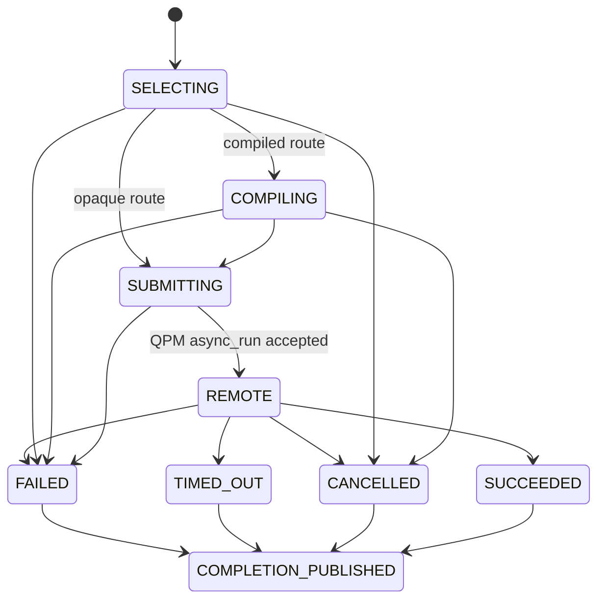

# Detailed Design

**Status:** draft

## Purpose

> **Prototype language:** This document specifies the Python prototype. Python classes, data classes, protocols, enums, and type annotations express the intended contracts. The final public design and implementation will be in C; its types, ownership rules, function signatures, and ABI will be defined separately from this prototype.

This design describes the SC26 library boundary and the flow from application program input to managed QPM execution and result delivery. The application owns algorithmic control flow, parameter updates, and data binding. libquantum owns route discovery and selection, compiler invocation, QRI submission, task tracking, and delivery to application completion queues. Graph construction and execution are future convenience layers over these APIs. The design maps to the observable behavior in `docs/requirements.md`; upstream proposals and the Backline prototype are not treated as available execution functionality.

**Status:** draft

## Application API

The public Python API has two top-level lifecycle functions and one stateful context class. `initialize()` creates all state scoped to the active QFw runtime. Every other operation is a method on that context, which prevents resource, route, task, or queue handles from being used with a different allocation.

Data structures used by this API are defined in these sections:

- [Shared Data Model](#shared-data-model): common `VersionSet`, `Diagnostic`, and `CorrelationData` records and the document's Python type conventions.
- [Program Representation](#program-representation): `Program`, `Representation`, and `ProgramRequirements`.
- [Device Representation](#device-representation): `Device`, capacity, format, topology, and internal device-access records.
- [Program Route](#program-route): `ProgramRoute`, which directly references the selected `Compiler` and `Device` representations.
- [Operation Records](#operation-records): `RouteConstraints`, compilation and execution options, compilation results, provenance, and `TaskHandle`.
- [Compiler Integration Contract](#compiler-integration-contract): the assembled `Compiler` representation, compiler metadata and capability records, registrations, and callback protocols.
- [Device Discovery Through QRI](#device-discovery-through-qri): `ResourceSnapshot`.
- [Initialization and Finalization](#initialization-and-finalization): context and finalization states plus `FinalizeResult`.
- [Compatibility Mapping](#compatibility-mapping): `CompatibilityMap`, `RouteQueryResult`, and rejected-route records.
- [Route Selection](#route-selection): `SelectionResult` and policy evidence.
- [Compilation and Execution](#compilation-and-execution): task phases, `TaskStatus`, remote task identity, and cancellation results.
- [Completion Queues](#completion-queues): `CompletionQueue`, `Completion`, and terminal outcomes.
- [Errors, Results, and Provenance](#errors-results-and-provenance): `LibquantumError`, `ErrorDetail`, and error stages.
- [SC26 Runtime and Qualification Boundary](#sc26-runtime-and-qualification-boundary): `InitConfig`, `RepresentationRegistry`, and representation recognizers.

```python
def initialize(config: InitConfig | None = None) -> Context: ...

def finalize(
    context: Context,
    timeout: float | None = None,
) -> FinalizeResult: ...


class Context:
    """Stateful handle for one active QFw allocation context."""

    @property
    def context_id(self) -> str: ...

    def refresh_resources(self) -> ResourceSnapshot: ...
    def list_compilers(self) -> tuple[Compiler, ...]: ...
    def list_devices(self) -> tuple[Device, ...]: ...

    def import_program(
        self,
        payload: object | bytes | str,
        *,
        representation: Representation | None = None,
        requirements: ProgramRequirements | None = None,
    ) -> Program: ...

    def list_routes(
        self,
        program: Program | None = None,
        constraints: RouteConstraints | None = None,
        explain: bool = False,
    ) -> RouteQueryResult: ...

    def select_route(
        self,
        program: Program,
        constraints: RouteConstraints | None = None,
        options: CompilationOptions | None = None,
    ) -> SelectionResult: ...

    def compile(
        self,
        program: Program,
        route: ProgramRoute | None = None,
        constraints: RouteConstraints | None = None,
        options: CompilationOptions | None = None,
    ) -> CompilationResult: ...

    def run(
        self,
        program: Program,
        completion_queue: CompletionQueue,
        route: ProgramRoute | None = None,
        constraints: RouteConstraints | None = None,
        compilation_options: CompilationOptions | None = None,
        execution_options: ExecutionOptions | None = None,
        correlation: CorrelationData | None = None,
    ) -> TaskHandle: ...

    def task_status(self, task: TaskHandle) -> TaskStatus: ...
    def cancel(
        self,
        task: TaskHandle,
        reason: str | None = None,
    ) -> CancellationResult: ...

    def create_completion_queue(
        self,
        name: str | None = None,
    ) -> CompletionQueue: ...

    # Future dedicated API. SC26 uses list_routes(..., explain=True).
    def compatibility(
        self,
        program: Program,
        compiler_id: str | None = None,
        device_id: str | None = None,
        options: CompilationOptions | None = None,
    ) -> CompatibilityReport: ...
```

Applications call `import_program()` after constructing a circuit or serialized payload with an SDK. The method classifies and validates the input through the context's representation registry and returns an immutable `Program`; it does not compile, serialize, copy, or submit the payload.

`Context` and `CompletionQueue` are stateful classes owned by libquantum. `TaskHandle` is an immutable opaque value. All other named arguments and results are immutable records declared in the data-model or owning-operation sections below.

The dedicated `compatibility()` method is future scope; `list_routes(..., explain=True)` provides SC26 compatibility details. `run()` is the only SC26 execution entry point and is asynchronous. A direct `run_compiled()` API is deferred with stored-artifact execution. Graph construction, graph execution, result processing, circuit cutting, public plugin loading, and configurable advanced policies remain outside SC26. Selection, successful compilation, QPM acceptance, and terminal completion are distinct outcomes.

**Status:** draft

## Shared Data Model

Every named contract uses one of the following Python forms. The declaration is shown in the same design section that defines its fields and behavior.

- `@dataclass(frozen=True)` is an immutable value record.
- `Enum` is a closed set of states or modes.
- `Protocol` is an interface implemented by an integration.
- A regular `class` is a stateful library-owned handle.
- An `Exception` subclass is raised by synchronous APIs; its structured detail remains an immutable record.
- Standard containers such as `tuple`, `frozenset`, and `Mapping` are containers rather than new libquantum structures.

Common records used by several contracts are declared here.

```python
@dataclass(frozen=True)
class VersionSet:
    """A normalized finite set or inclusive range accepted by the registry."""

    values: tuple[str, ...] = ()
    minimum: str | None = None
    maximum: str | None = None


@dataclass(frozen=True)
class Diagnostic:
    code: str
    message: str
    severity: Literal["info", "warning", "error"]
    details: Mapping[str, object] = field(default_factory=dict)


@dataclass(frozen=True)
class CorrelationData:
    """Application data copied unchanged into task status and completion."""

    application_id: str | None = None
    operation_id: str | None = None
    values: Mapping[str, object] = field(default_factory=dict)
```

Public records are immutable. Handles contain context identity and opaque local identifiers; callers do not construct them. Canonical identifiers are lowercase namespaced strings. Version fields describe the represented contract or implementation and are never inferred from an unrelated package version.

**Status:** draft

### Program Representation

`Program` is an immutable value record returned by `Context.import_program()`. It describes the program and preserves the caller's original object or payload. It contains no compiler or execution destination; those decisions belong to `ProgramRoute`. Compilation produces a separate `CompilationResult` and never replaces the source. Applications do not call the `Program` constructor directly because recognition and validation depend on the context's `RepresentationRegistry`.

```python
class ProgramKind(str, Enum):
    SDK_OBJECT = "sdk_object"
    SERIALIZED = "serialized"
    OPAQUE = "opaque"


@dataclass(frozen=True)
class Representation:
    kind: ProgramKind
    name: str                    # qiskit.quantum-circuit, openqasm, qiskit.qpy
    version: str | None          # format or object-contract version
    sdk: str | None              # originating SDK when known
    sdk_version: str | None
    object_type: str | None      # fully qualified Python type for SDK objects


@dataclass(frozen=True)
class ProgramRequirements:
    logical_qubits: int | None = None
    required_features: frozenset[str] = frozenset()
    workload_kind: str = "quantum"


@dataclass(frozen=True)
class Program:
    payload: object | bytes | str
    representation: Representation
    requirements: ProgramRequirements = ProgramRequirements()
```

The intended application flow is:

```python
circuit = QuantumCircuit(...)
program = context.import_program(circuit)
route = context.select_route(program)
task = context.run(program, completion_queue, route=route)
```

`import_program()` performs normalization in this deterministic order.

1. If the caller supplies `representation`, libquantum validates it against the context registry and uses it.
2. Otherwise, an exact registered Python-type match identifies supported SDK objects. For example, a Qiskit `QuantumCircuit` maps to `qiskit.quantum-circuit`; `sdk_version` comes from the installed Qiskit distribution. Subclasses are accepted only when the recognizer explicitly declares them.
3. Otherwise, built-in recognizers may identify a serialized format only from an unambiguous, validated signature. OpenQASM requires its `OPENQASM <version>;` declaration. QPY requires its valid header and encoded QPY version. Compressed or wrapper formats require an explicit representation unless their outer format has its own registered signature.
4. If recognition is ambiguous or fails, `import_program()` raises `LibquantumError` with `ErrorStage.PROGRAM_IMPORT` and code `UNKNOWN_REPRESENTATION`. libquantum does not silently reinterpret the value as opaque.
5. To import opaque data, the caller supplies an explicit `Representation(kind=ProgramKind.OPAQUE, name="opaque", version=None, ...)`. No destination is supplied during import.

Canonical representation names and version meaning form a small libquantum registry. Compiler integrations report support using those identifiers; they do not invent aliases during registration. Parameter bindings, compilation controls, shot count, correlation data, and execution destination are operation or route inputs rather than properties of the reusable source program. A compiler's `analyze()` callback fills missing program requirements before capacity filtering; caller-supplied requirements are constraints and cannot be weakened by the callback.

**Status:** draft

### Device Representation

The public `Device` is an immutable, allocation-scoped snapshot. `DeviceAccessContext` is a separate internal immutable record containing live QFw bindings and credentials; public APIs never return it.

```python
@dataclass(frozen=True)
class FormatSupport:
    representation: str
    versions: VersionSet
    preference: int              # 0 is the device's highest preference
    native: bool


@dataclass(frozen=True)
class DeviceCapacity:
    physical_qubits: int | None
    usable_qubits: int | None
    capacity_source: str


@dataclass(frozen=True)
class CouplingEdge:
    source: int
    target: int


@dataclass(frozen=True)
class CouplingGraph:
    qubit_count: int
    edges: tuple[CouplingEdge, ...]
    directed: bool


@dataclass(frozen=True)
class Device:
    device_id: str
    display_name: str | None
    provider: str | None
    allocation_id: str
    reservation_id: str
    qpm_service_id: str
    qpm_instance_id: str
    execution_api_version: str
    accepted_inputs: tuple[FormatSupport, ...]
    capacity: DeviceCapacity
    operations: tuple[str, ...]
    coupling_graph: CouplingGraph | None
    calibration_snapshot_id: str | None
    telemetry_library: str | None       # QRMI/QDMI selector used by the QPM
    metadata_source: str
    metadata_complete: bool
    snapshot_generation: str


@dataclass(frozen=True)
class DeviceAccessContext:
    """Internal record passed to compiler integrations, never applications."""

    execution_binding: object
    telemetry_binding: object
    token: object | None
    reservation_id: str
    qpm_service_id: str
    telemetry_library: str | None
```

`Device.accepted_inputs` is ordered by `preference`; the native device format has the highest preference. The explicit integer is retained so ordering remains stable across serialization and the final C representation. `usable_qubits` is the capacity used for route eligibility. `physical_qubits` is descriptive and cannot substitute for a smaller reservation limit. `metadata_complete=False` prevents a generic fallback from being presented as a fully characterized target. Multiple routes reference the same `device_id` and `snapshot_generation`.

**TODO — QEC and classical resources:** define the QEC codes, decoder/controller/coprocessor capabilities, classical memory/compute constraints, placement data, and versioned schemas needed by Catalyst/Backline routes. Do not add unversioned catch-all fields to `Device`; add typed capability records after the required QRI contracts and selection semantics are known.

**Status:** draft

### Program Route

A `ProgramRoute` is an immutable value record representing one concrete compiler-input/compiler-output/device-input mapping. It references capability records already owned by the selected `Compiler` and `Device`; it does not introduce parallel capability descriptions.

```python
@dataclass(frozen=True)
class ProgramRoute:
    route_id: str
    compatibility_generation: str

    compiler: Compiler | None
    compiler_input: InputCapability | None
    compiler_output: OutputCapability | None

    device: Device
    device_input: FormatSupport | None

    negotiated_output_version: str | None
```

For a compiled route:

- `compiler_input` is one entry from `compiler.input_capabilities`.
- `compiler_output` is one entry from `compiler.output_capabilities`.
- `device_input` is one entry from `device.accepted_inputs`.
- `compiler_output.representation == device_input.representation`.
- `negotiated_output_version` belongs to the intersection of the compiler-output and device-input version sets.

The compiler contract guarantees that every advertised input capability can be compiled into every advertised output capability. Therefore a route can represent the Cartesian-product edge directly; no separate transformation record is required.

For an opaque route, `compiler`, `compiler_input`, `compiler_output`, `device_input`, and `negotiated_output_version` are all `None`. libquantum forwards `Program.payload` unchanged through the QPM service and reservation recorded by `device`, with no compiler or format claim.

`route_id` is a deterministic digest of the compatibility generation, compiler identity/version when present, selected input and output capabilities when present, negotiated output version when present, and the device's allocation, service, reservation, identity, and snapshot generation. It contains no ranking score. A route becomes stale when its compatibility generation differs from the context's current generation.

The route never contains callback objects or initialized compiler state. `Context` uses `route.compiler.info.compiler_id` to locate the live callbacks and state. In the final C design, the route can retain handles or references to immutable compiler/device descriptions while the context owns their storage and runtime state.

**Status:** draft

### Operation Records

The following immutable records define caller constraints, operation options, compilation provenance/results, and the opaque task handle.

```python
@dataclass(frozen=True)
class RouteConstraints:
    route_id: str | None = None
    compiler_id: str | None = None
    device_id: str | None = None
    qpm_service_id: str | None = None
    allow_alternatives: bool = False


@dataclass(frozen=True)
class CompilationOptions:
    """Namespaced values validated against the selected compiler schema."""

    values: Mapping[str, object] = field(default_factory=dict)


@dataclass(frozen=True)
class ExecutionOptions:
    shots: int | None = None
    parameter_bindings: Mapping[str, object] = field(default_factory=dict)
    timeout: float | None = None
    values: Mapping[str, object] = field(default_factory=dict)


@dataclass(frozen=True)
class CompilerProvenance:
    compiler_id: str
    compiler_version: str
    source_representation: Representation
    output_representation: Representation
    target_source: str | None
    additional_stages: tuple[str, ...] = ()


@dataclass(frozen=True)
class CompilationResult:
    source: Program
    route: ProgramRoute
    payload: object | bytes | str
    representation: Representation
    compiler_provenance: CompilerProvenance
    target_snapshot: object | None
    diagnostics: tuple[Diagnostic, ...] = ()


@dataclass(frozen=True)
class TaskHandle:
    """Opaque identifier returned after run() accepts local work."""

    context_id: str
    task_id: str
```

All extensible option maps use namespaced keys and a declared schema. Unknown keys are rejected rather than ignored. `CompilationResult` is an inspection record and is not directly executable in SC26; retaining it supports compilation-only use and the future stored-artifact API.

**Status:** draft

## Compiler Integration Contract

SC26 uses a static set of Python compiler registrations. Every compiler-facing structure and callback is declared in this contract block.

```python
@dataclass(frozen=True)
class CompilerInitContext:
    context_id: str
    configuration: Mapping[str, object]


@dataclass(frozen=True)
class CompilerInfo:
    compiler_id: str
    display_name: str
    version: str
    available: bool
    unavailable_reason: str | None
    supported_features: frozenset[str]
    configuration_fingerprint: str
    option_schema: Mapping[str, object]


class InputMode(str, Enum):
    NATIVE = "native"
    CONVERTED = "converted"


@dataclass(frozen=True)
class InputCapability:
    representation: str
    versions: VersionSet
    preference: int              # 0 is the compiler's highest preference
    mode: InputMode
    required_features: frozenset[str] = frozenset()
    target_constraints: Mapping[str, object] = field(default_factory=dict)


@dataclass(frozen=True)
class OutputCapability:
    representation: str
    versions: VersionSet
    preference: int              # 0 is the compiler's highest preference
    native: bool
    serializer_id: str
    target_constraints: Mapping[str, object] = field(default_factory=dict)


@dataclass(frozen=True)
class Compiler:
    """Immutable representation assembled from callback results."""

    info: CompilerInfo
    input_capabilities: tuple[InputCapability, ...]
    output_capabilities: tuple[OutputCapability, ...]


@dataclass(frozen=True)
class ProgramAnalysis:
    logical_qubits: int | None
    required_features: frozenset[str]
    complete_for_selection: bool
    diagnostics: tuple[Diagnostic, ...] = ()


@dataclass(frozen=True)
class CompatibilityRequest:
    program: Program
    analysis: ProgramAnalysis
    device: Device
    device_access: DeviceAccessContext
    output_representation: str
    output_version: str
    options: CompilationOptions


@dataclass(frozen=True)
class CompatibilityReport:
    compatible: bool
    reason_codes: tuple[str, ...]
    diagnostics: tuple[Diagnostic, ...] = ()
    required_target_data: tuple[str, ...] = ()
    estimates: Mapping[str, float] = field(default_factory=dict)


@dataclass(frozen=True)
class CompilerRequest:
    program: Program
    device: Device
    device_access: DeviceAccessContext
    output_representation: str
    output_version: str
    options: CompilationOptions


@dataclass(frozen=True)
class CompilerResult:
    payload: object | bytes | str
    representation: Representation
    source_snapshot: object | None
    target_snapshot: object | None
    layout: object | None
    parameter_metadata: Mapping[str, object]
    provenance: CompilerProvenance
    diagnostics: tuple[Diagnostic, ...] = ()


class CompilerCallbacks(Protocol):
    def initialize(self, context: CompilerInitContext) -> object: ...
    def describe(self, state: object) -> CompilerInfo: ...
    def input_capabilities(
        self, state: object
    ) -> tuple[InputCapability, ...]: ...
    def output_capabilities(
        self, state: object
    ) -> tuple[OutputCapability, ...]: ...
    def analyze(
        self, state: object, program: Program
    ) -> ProgramAnalysis: ...
    def check_compatibility(
        self, state: object, request: CompatibilityRequest
    ) -> CompatibilityReport: ...
    def compile(
        self, state: object, request: CompilerRequest
    ) -> CompilerResult: ...
    def finalize(self, state: object) -> None: ...


@dataclass(frozen=True)
class CompilerRegistration:
    compiler_id: str
    callbacks: CompilerCallbacks
    configuration: Mapping[str, object] = field(default_factory=dict)
```

`InputCapability` and `OutputCapability` preferences are stable nonnegative ranks; lower values are preferred. Native capabilities must rank ahead of converted or non-native capabilities. The integration contract guarantees a full cross-product: every advertised input capability can be compiled into every advertised output capability. An integration that cannot satisfy that invariant must register narrower compiler representations rather than advertise unrelated input and output sets.

`initialize()` may allocate compiler-owned state and is called once per context. libquantum calls `describe()`, `input_capabilities()`, and `output_capabilities()` and assembles their results into one immutable `Compiler`. `Context.list_compilers()` returns these representations. Capability callbacks are queried again only after explicit refresh or configuration change. `check_compatibility()` is called for each candidate route and actual program. `compile()` performs any integration-owned input conversion and output serialization; libquantum verifies that its result matches the selected route. `finalize()` must tolerate repeated cleanup after partial initialization.

Callbacks raise or return structured failures that libquantum converts to `LibquantumError` with stable codes. Provider credentials are absent from public callback results. A compiler that needs target data receives the internal `DeviceAccessContext`, preserving allocation, service, reservation, and library identity. `Context` separately retains each registration's callback object and initialized state, keyed by `Compiler.info.compiler_id`; neither is embedded in `Compiler` or `ProgramRoute`.

**Status:** draft

## Device Discovery Through QRI

Discovery begins with the active QFw resolver/directory context and retains only QPM services belonging to the current allocation and reservation set. For each service, libquantum binds the public execution and telemetry APIs. The result is an immutable `ResourceSnapshot`.

```python
@dataclass(frozen=True)
class ResourceSnapshot:
    generation: str
    devices: tuple[Device, ...]
    captured_at: datetime
    diagnostics: tuple[Diagnostic, ...] = ()
```

At the reviewed QFw revision, device collection uses these telemetry calls.

| QPM telemetry call | Use in libquantum |
| --- | --- |
| `get_backend_info(lib=None, token=None, reservation_id=None)` | Establish backend/device identity, static architecture, advertised metadata support, and shim library context. |
| `get_device_info(lib=None, token=None)` | Obtain the qhw device properties and native operation data. |
| `get_coupling_graph(calibration_set_id=None, lib=None, token=None)` | Obtain topology used by compiler target construction. |
| `get_calibration_snapshot(calibration_set_id=None, lib=None, token=None)` | Obtain the calibration snapshot and its identity for compiler provenance. |
| `get_dynamic_backend_info(calibration_set_id=None, lib=None, token=None)` | Optional QRMI-specific dynamic target data when the selected integration requires it. |
| `capability_map(token=None)` | Verify which QRMI/QDMI library path implements required telemetry calls. |
| `get_capacity_snapshot(token=None, device_id=None, scope_id=None, access_class=None)` | Obtain current usable capacity and reservation/held-capacity context. |
| `get_queue_metrics(token=None, device_id=None, access_class=None)` | Future turnaround-time policy only; it is not needed by the SC26 default selector. |

Accepted submission formats and versions must come from an authoritative QPM/QRI advertisement. The existing `circuit_formats` and `qpy_version` properties may seed `accepted_inputs`, but a format is included only if the same execution path guarantees it accepts that format. A default property from a generic query helper is insufficient evidence. **TODO:** settle whether QFw extends the current properties or adds a public versioned format-capability call.

There is an authorization asymmetry in the reviewed telemetry surface: `get_backend_info` accepts `reservation_id`, while the other target calls do not. Initialization records this limitation and marks metadata incomplete when the active identity cannot retrieve the selected device's target data. **TODO:** qualify or extend reservation-scoped access for every target call used by compilation.

`refresh_resources()` repeats discovery and telemetry collection, compares normalized records, and creates a new resource and compatibility generation when any selection-relevant fact changes. It does not mutate old route objects. Compiler callbacks may retrieve target details through the stored internal access context, but the normalized `Device` remains the common application-facing view.

**Status:** draft

## Initialization and Finalization

The lifecycle API uses closed context/finalization states and an immutable result record.

```python
class ContextState(str, Enum):
    INITIALIZING = "initializing"
    READY = "ready"
    FINALIZING = "finalizing"
    FINALIZED = "finalized"


class FinalizeStatus(str, Enum):
    FINALIZED = "finalized"
    TIMED_OUT = "timed_out"
    ALREADY_FINALIZED = "already_finalized"


@dataclass(frozen=True)
class FinalizeResult:
    status: FinalizeStatus
    unfinished_tasks: tuple[TaskHandle, ...] = ()
    diagnostics: tuple[Diagnostic, ...] = ()
```

`initialize()` performs these steps in order.

1. Read the active QFw runtime, allocation, reservation set, resolver scope, and credentials/token context. Generate a context identity.
2. Resolve allocation-visible QPM services and bind each service's public execution and telemetry APIs.
3. Register configured compiler integrations. Call `initialize()`, then collect identity, input, output, option, and feature capabilities.
4. Build the allocation-scoped `ResourceSnapshot` through the QRI calls in this design.
5. Build the compatibility mapping and its generation identifier.
6. Create the local task registry and completion dispatcher. Register QPM event notification for reservation scopes owned by this context; retain every registration identifier for cleanup.
7. Change the context state to `READY`. Lazy compiler or service connections are allowed only when their absence does not prevent route enumeration.

A failure reports the step, service/compiler identity, and structured cause. Initialization unwinds completed steps in reverse order and unregisters any listener already created. It never creates or releases the external allocation or reservation.

`finalize(context, timeout)` is idempotent and performs these steps.

1. Atomically change `READY` to `FINALIZING` so new compile and run operations are rejected.
2. Allow accepted local selection/compilation/submission work and submitted QPM tasks to reach terminal handling until `timeout`.
3. Drain already received terminal events into their assigned queues. Normal finalization does not implicitly cancel work; callers use `cancel()` when cancellation is desired.
4. If the timeout expires, return `FinalizeStatus.TIMED_OUT` with every unfinished handle, retain bindings required for status/cancel/retry, and remain `FINALIZING`.
5. Once no required work remains, unregister event notifications, close library-owned dispatcher resources and queues, finalize compiler integrations in reverse order, release library-owned connections, and enter `FINALIZED`.
6. A later call returns `ALREADY_FINALIZED` without repeating remote effects.

A disconnected service or unsupported cancellation produces an unknown task outcome; neither case is reported as confirmed cancellation. Finalization never shuts down a shared QPM or releases launcher-owned allocation/reservation state.

**Status:** draft

## Compatibility Mapping

The compatibility map and route-query response are immutable records. The map has indexes for all routes, compiler inputs, devices, and opaque forwarding routes. It is rebuilt rather than patched in place.

```python
@dataclass(frozen=True)
class RejectedRoute:
    route_id: str
    stage: str
    reason_codes: tuple[str, ...]
    diagnostics: tuple[Diagnostic, ...] = ()


@dataclass(frozen=True)
class CompatibilityMap:
    generation: str
    routes_by_id: Mapping[str, ProgramRoute]
    routes_by_input: Mapping[tuple[str, str], tuple[str, ...]]
    routes_by_device: Mapping[str, tuple[str, ...]]
    opaque_routes: tuple[str, ...]


@dataclass(frozen=True)
class RouteQueryResult:
    compatibility_generation: str
    routes: tuple[ProgramRoute, ...]
    rejected: tuple[RejectedRoute, ...] = ()
```

Compiled routes are built from the declared cross-product.

1. For every assembled `Compiler`, iterate over each `compiler.input_capabilities` entry and each `compiler.output_capabilities` entry.
2. For every allocated `Device`, compare the compiler output with each entry in `device.accepted_inputs`.
3. Continue only when the compiler output and device input have the same representation and their version sets intersect.
4. For each concrete negotiated version in the intersection, create one `ProgramRoute` referencing the compiler input, compiler output, device, and device input records and recording the negotiated output version.
5. Index the route under every concrete input version represented by `compiler_input.versions`, and under `device.device_id`.
6. Compute `route_id` from the selected capabilities, negotiated output version, compiler, device/service/reservation, snapshot, and compatibility generation.

For example, a compiler advertising QPY input and OpenQASM 3 output creates a QPY-to-OpenQASM-3 route to an IQM device only when that device advertises a compatible OpenQASM 3 input version. A device's higher-preference JSON input produces no route unless the compiler also advertises compatible JSON output.

Opaque routes are constructed separately. Each allocation-visible `Device` that permits the existing opaque forwarding contract receives one `ProgramRoute` with all compiler and format fields set to `None`. It appears in `routes_by_id`, `routes_by_device`, and `opaque_routes`, but never in `routes_by_input`. The opaque route asserts only that the device's QPM service/reservation is authorized and reachable; the receiving QPM validates the payload.

The startup map establishes structural compatibility only. A recognized program query runs the referenced compiler's `analyze()` and `check_compatibility()` callbacks because program constructs, options, usable capacity, target completeness, or reservation limits can reject a structurally valid route. `list_routes(..., explain=True)` populates `rejected`; otherwise it may leave that tuple empty.

A mapping generation fingerprints compiler identity/version/configuration and ordered capabilities, device snapshot generations and ordered accepted inputs, QPM service/reservation identity, opaque-forwarding availability, and the representation registry version. A caller cannot select, compile, or run with a stale route; it must query/select again against the current generation.

**Status:** draft

## Route Selection

Selection is a pure operation over one compatibility generation. Its result and policy evidence are immutable records.

```python
@dataclass(frozen=True)
class PolicyValue:
    policy: str
    value: object
    explanation: str


@dataclass(frozen=True)
class SelectionResult:
    program_representation: Representation
    route: ProgramRoute
    effective_constraints: RouteConstraints
    policy_values: tuple[PolicyValue, ...]
    compatibility_generation: str
    reasons: tuple[str, ...]
```

Recognized programs perform eligibility checks before preferences.

1. Start from `routes_by_input` and retain routes whose `compiler_input.representation` and `compiler_input.versions` accept the imported program's representation and version.
2. Apply an explicit `route_id`, `compiler_id`, `device_id`, or `qpm_service_id` as a hard constraint. Compiler constraints compare `route.compiler.info.compiler_id`; device and service constraints compare fields on `route.device`. An incompatible explicit choice fails unless `allow_alternatives=True` was explicitly set.
3. Reject routes missing compiled capability fields, whose compiler is unavailable, whose compatibility callback rejects the program/options, whose selected output/device-input versions no longer agree, whose target metadata is insufficient, or whose `device.capacity.usable_qubits` is below the analyzed requirement.
4. Rank the remaining routes with the SC26 policy tuple below. The lowest tuple wins.

```text
(
  device usable-qubit capacity,             # smallest sufficient device first
  compiler_input.preference,                # native inputs rank first
  device_input.preference,                  # device-native formats rank first
  compiler_output.preference,               # compiler-native outputs rank first
  device-specific compiler priority,
  global compiler priority,
  route_id                                   # stable deterministic tie break
)
```

Capability integrations must rank native support ahead of converted/non-native support, so the explicit preference values implement the native-format policies while retaining a deterministic order among capabilities of the same class. An explicit device removes device-size comparison among other devices; an explicit compiler removes compiler-priority comparison among other compilers. Device-specific compiler priority overrides global priority only for that device. Missing priorities sort after configured entries. `policy_values` records the winning rank components; `reasons` summarizes eligibility and the deterministic tie break.

Opaque programs use only routes whose compiler and format fields are absent. The caller must supply a `route_id` or device/service constraints that resolve to exactly one opaque route. A compiler constraint is invalid for an opaque program. libquantum does not rank opaque destinations or infer payload compatibility; zero matches produce `NO_OPAQUE_ROUTE`, and multiple matches produce `AMBIGUOUS_OPAQUE_ROUTE`.

Trial-compilation metrics, execution-quality estimates, turnaround time, affinity, and graph distribution policies are deferred. Selection never changes the chosen route after QPM acceptance or after an uncertain submission outcome.

**Status:** draft

## Compilation and Execution

Compilation is synchronous; execution is represented by a stateful task whose public view is an immutable `TaskStatus`.

```python
class TaskPhase(str, Enum):
    SELECTING = "selecting"
    COMPILING = "compiling"
    SUBMITTING = "submitting"
    REMOTE = "remote"
    SUCCEEDED = "succeeded"
    FAILED = "failed"
    TIMED_OUT = "timed_out"
    CANCELLATION_REQUESTED = "cancellation_requested"
    CANCELLED = "cancelled"
    OUTCOME_UNKNOWN = "outcome_unknown"


@dataclass(frozen=True)
class RemoteTaskIdentity:
    qpm_service_id: str
    reservation_id: str
    circuit_id: str | None
    qpm_task_id: str | None
    scheduler_task_id: str | None


@dataclass(frozen=True)
class TaskStatus:
    task: TaskHandle
    phase: TaskPhase
    route: ProgramRoute | None
    remote: RemoteTaskIdentity | None
    terminal: bool
    diagnostics: tuple[Diagnostic, ...] = ()


class CancellationState(str, Enum):
    REQUESTED = "requested"
    CONFIRMED = "confirmed"
    UNSUPPORTED = "unsupported"
    OUTCOME_UNKNOWN = "outcome_unknown"
    ALREADY_TERMINAL = "already_terminal"


@dataclass(frozen=True)
class CancellationResult:
    task: TaskHandle
    state: CancellationState
    status: TaskStatus
```

`compile()` accepts only a recognized program and a route with non-null compiler, compiler-input, compiler-output, device-input, and negotiated-output-version fields. It validates the context and route generation, verifies that the program matches `route.compiler_input`, locates the live callbacks and initialized state through `route.compiler.info.compiler_id`, invokes `compile()` with the original program and `route.device` access context, and verifies the returned representation/version against `route.compiler_output.representation` and `route.negotiated_output_version`. It returns `CompilationResult` and performs no QPM execution call. Passing an opaque program or opaque route raises `OPAQUE_NOT_COMPILABLE`.

`run()` accepts a local task before work begins. It allocates `task_id`, atomically pairs it with the selected completion queue and correlation data, stores a source-program reference, and schedules this phase machine:



For a compiled route, libquantum invokes the callbacks associated with `route.compiler`, verifies the result against `route.compiler_output.representation` and `route.negotiated_output_version`, serializes it with the existing QFw payload mechanism, and submits it through the QPM service and reservation recorded by `route.device`. For an opaque route, libquantum skips compiler callbacks and serialization and submits `Program.payload` unchanged through the QPM service and reservation recorded by `route.device`. In both cases submission calls `QPMExecution.async_run(info, reservation_id, token, timeout, cancel_on_timeout=False)`, carries execution options and correlation/trace context, and records returned remote identifiers before reporting `TaskPhase.REMOTE`.

`task_status()` reports local phases through submission. After QPM acceptance it calls `QPMExecution.task_status(cid, reservation_id, token, qtask_id)` on the owning path; QPM remains authoritative. Optional diagnosis calls `get_task_metadata()` and `get_task_timing()` on that path. `cancel()` stops local work or calls `cancel_task(cid, reservation_id, token, reason, qtask_id)`. A request is not confirmed until QPM reports it.

An opaque program must use a route whose compiler and format fields are absent, and a recognized program must use a route where all of them are present. A mismatched program/route pair fails before submission. Both paths receive a local task, status, cancellation, and exactly one terminal completion.

**Status:** draft

## Completion Queues

A completion queue is a stateful application-facing class associated with exactly one context. Any number of independent tasks may share it; each task is paired with exactly one queue when `run()` accepts the task, and that pairing is immutable. `Completion` is an immutable value record. `QhwData` is the existing external qhw-data result type rather than a libquantum-defined structure.

```python
class CompletionOutcome(str, Enum):
    SUCCEEDED = "succeeded"
    FAILED = "failed"
    TIMED_OUT = "timed_out"
    CANCELLED = "cancelled"


@dataclass(frozen=True)
class Completion:
    task: TaskHandle
    correlation: CorrelationData | None
    outcome: CompletionOutcome
    result: QhwData | None
    error: ErrorDetail | None
    route: ProgramRoute | None
    remote: RemoteTaskIdentity | None


class CompletionQueue:
    """Stateful FIFO handle; storage and synchronization are context-owned."""

    @property
    def queue_id(self) -> str: ...

    def wait(self, timeout: float | None = None) -> bool:
        """Wait for availability without consuming a completion."""
        ...

    def peek(self) -> Completion | None:
        """Inspect the next completion without consuming it."""
        ...

    def get(self) -> Completion | None:
        """Consume the next completion immediately, or return None."""
        ...

    def close(self) -> None: ...
```

`wait()` returns `False` on caller timeout and changes neither task state nor queue contents. `peek()` and `get()` are nonblocking. A queue cannot be closed while paired nonterminal tasks exist; finalization closes queues after their tasks are resolved. Consuming a successful completion transfers ownership of its unmodified `QhwData` result to the application.

The context maintains `task_id -> queue_id`, `(qpm_service_id, reservation_id, circuit_id/qpm_task_id) -> task_id`, and `task_id -> terminal_publication` tables. It registers QPM event notification with reservation and task filters when supported, then uses `peek_cq`/`read_cq` only for records owned by this context. Every event is validated against the owning service and reservation. The first terminal event atomically records the terminal outcome and enqueues one `Completion`; duplicates and late contradictory events are retained as diagnostics and cannot replace the published outcome. Listener registration identifiers are unregistered during successful finalization.

Asynchronous failures store `ErrorDetail`, not an exception object, in the completion. Local selection, compilation, or submission failure also publishes one terminal completion because `run()` already accepted a local task. A direct synchronous `compile()` failure does not use a completion queue.

**Status:** draft

## Errors, Results, and Provenance

Synchronous APIs raise `LibquantumError`, a normal exception containing immutable structured detail. Asynchronous failures place the same exception detail on the terminal `Completion`.

```python
class ErrorStage(str, Enum):
    INITIALIZATION = "initialization"
    DISCOVERY = "discovery"
    PROGRAM_IMPORT = "program_import"
    SELECTION = "selection"
    COMPILATION = "compilation"
    SUBMISSION = "submission"
    EXECUTION = "execution"
    CANCELLATION = "cancellation"
    FINALIZATION = "finalization"


@dataclass(frozen=True)
class ErrorDetail:
    stage: ErrorStage
    code: str
    message: str
    diagnostics: tuple[Diagnostic, ...] = ()
    task: TaskHandle | None = None
    correlation: CorrelationData | None = None
    route: ProgramRoute | None = None
    requested_constraints: RouteConstraints | None = None
    remote: RemoteTaskIdentity | None = None


class LibquantumError(Exception):
    def __init__(self, detail: ErrorDetail):
        self.detail = detail
        super().__init__(detail.message)
```

Normal diagnostics omit tokens, credentials, and provider secrets. QPM result payloads remain the external `QhwData` type; libquantum does not convert or interpret them. Completion provenance identifies the original representation and SDK when known, compiler identity/version or explicit compiler bypass, target snapshot, selected route, QPM service/reservation, and remote task. Trace context is forwarded through QFw rather than replaced. Missing calibration, provider timing, or trace fields remain absent and are not fabricated.

The SC26 implementation retains provenance in task and completion records long enough for normal inspection. A separate telemetry database, result-transformation pipeline, and application result processors are deferred.

**Status:** draft

## SC26 Runtime and Qualification Boundary

The SC26 implementation is Python and joins the runtime prepared by `qfw-activate`, `qfw-setup`, and `qfw-srun`. Initialization configuration and the representation-recognition contract have explicit Python forms.

```python
class RepresentationRecognizer(Protocol):
    def identify(
        self,
        value: object | bytes | str,
    ) -> Representation | None: ...


@dataclass(frozen=True)
class RepresentationRegistry:
    version: str
    recognizers: tuple[RepresentationRecognizer, ...]


@dataclass(frozen=True)
class InitConfig:
    compilers: tuple[CompilerRegistration, ...]
    compiler_priority: tuple[str, ...] = ()
    device_compiler_priority: Mapping[str, tuple[str, ...]] = field(
        default_factory=dict
    )
    representation_registry: RepresentationRegistry | None = None
```

`initialize()` reads `QFW_RESERVATIONS` as a JSON list of `[service_id, reservation_id]` pairs, retains every authorized pair, normalizes decimal-string reservation identifiers at service boundaries, and resolves each pair through the active QFw directory scope. A legacy single reservation value is not allowed to collapse a multi-service allocation. Runtime location, directory scope, reservation identity, and QPM bindings come from QFw rather than `InitConfig`. Credentials remain in QFw-owned contexts.

The implementation reuses QFw telemetry-to-target conversion helpers through a backend-independent boundary and reuses `util.circuit_payload` for serialization; it does not construct `QFwBackend` or introduce another wire envelope, reservation protocol, service plane, scheduler, credential store, or telemetry database.

The demonstration snapshot must record QFw and cluster commits, included PR commits, Python and dependency versions, compiler identities/versions, representation registry version, selected input/output formats, device/service/reservation identities, site configuration identity, and whether each result came from physical hardware, a mock, or a simulator. Readiness requires both IBM and IQM to appear in one allocation with their actual usable capacity; multiple `shim` services remain distinct by service and device identity. Each qualified compiler must produce a payload accepted by its selected QPM, with parameter values, compilation options, layout, and any QFw-side recompilation recorded.

The runnable route set must include Qiskit, MQT Core, and Catalyst integrations with visible availability and at least one qualified QRI route per compiler. Catalyst remains a failed readiness gate until a compiled artifact is submitted through QRI and receives managed QPM task/result semantics; direct submission to `catalyst-executor` does not qualify. Physical IBM and IQM execution, multiple completion queues, shared-queue correlation, duplicate suppression, failure, cancellation, caller wait timeout, and listener cleanup are required deployment evidence rather than new API concepts.

Graph APIs, classical graph nodes, stored-artifact execution, advanced policies, result transformation/circuit cutting, native C interfaces, pass composition, and public plugin loading remain deferred. libquantum does not infer algorithms, bind one task's result into another task, replace compiler/provider internals, implement admission or scheduling, or claim conversion between unrelated gate, analog, hybrid, and runtime program families.

**Status:** draft

## Requirements Coverage and Open Work

The design is ordered by the public constructs applications and integrations use. It covers the requirements sections as follows.

| Requirements section | Design section |
| --- | --- |
| Initialization and Finalization | Initialization and Finalization |
| Allocation Device Discovery and Unified Device Representation | Device Representation; Device Discovery Through QRI |
| Unified Program Representation | Program Representation |
| Compiler Registration and Support | Compiler Integration Contract |
| Compatibility Mapping | Program Route; Compatibility Mapping |
| Explicit and Automatic Selection; Selection Policies | Route Selection |
| Compilation and Execution APIs | Application API; Compilation and Execution |
| Completion Queues; Program Results and Delivery | Completion Queues; Errors, Results, and Provenance |
| Application Control | Application API; `run()` leaves submission ordering with application code |
| Diagnostics and Provenance | Errors, Results, and Provenance |
| QFw Integration Boundaries | Device Discovery Through QRI; Compilation and Execution |
| Graph Construction and Graph Executor | Deferred; future layers must call the same public API |
| Native Interfaces and Compiler Extensibility | Deferred beyond the static SC26 Python registrations |

Open work before the contracts can be frozen:

- Confirm the canonical representation registry and exact supported Qiskit and PennyLane object/serialized subsets.
- Define authoritative QPM input-format/version advertisement and its version negotiation rules.
- Resolve reservation-scoped authorization for every telemetry method used to build compiler targets.
- Define QEC and classical resource records and identify their QRI sources before designing Catalyst/Backline routes.
- Freeze `CompilerInfo` option schemas and all structured error/reason codes.
- Confirm QFw event types and filters used by the completion dispatcher and the exact ownership-safe `peek_cq`/`read_cq` procedure.
- Qualify payload serialization, parameter bindings, layout preservation, and any QFw fallback compilation for each SC26 route.
- Resolve the Catalyst compiled-artifact submission contract and QPM lifecycle before treating Backline as an executable QRI route.
- Freeze the installable QFw, Qiskit, PennyLane, MQT, and Catalyst revisions used by the demonstration.

**Status:** draft
