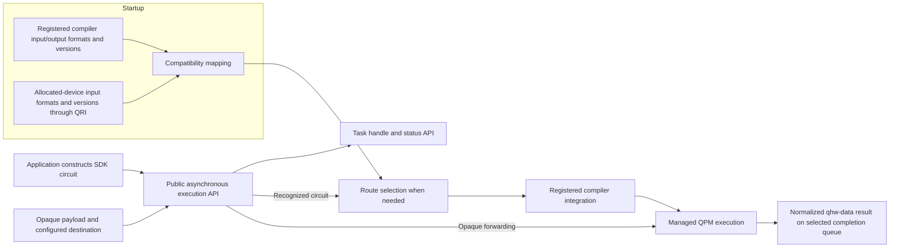

# libquantum Requirements

**Status:** draft

## Goal

> **An application can construct a quantum program with one SDK, compile it with another toolchain, and execute it through QRI without submitting through an SDK execution backend.**

libquantum provides public application APIs for resource discovery, route selection, compilation, execution, task observation, and result delivery. Graph construction and its executor are optional convenience layers outside the SC26 milestone and use the same public APIs as applications. The SDK used to express a program, the compiler used to transform it, and the hardware used to execute it can vary independently across explicitly supported combinations.

An application owns algorithmic control flow, parameter updates, and data binding. Programs and their compiler/runtime integrations own qubit operations, parameter binding, measurement ordering, and result interpretation. libquantum uses program-level capability and resource metadata to select routes, submit whole programs, and deliver program-level results. Application code controls program ordering through the public APIs; a future graph executor can provide sequential or concurrent ordering as a convenience. Independent tasks may progress concurrently. The library does not infer an algorithm from a circuit or invent workflow logic.

QRI means the quantum resource interface boundary. In the SC26 deployment, libquantum reaches that boundary through QFw's managed QPM execution and telemetry APIs; QRMI, QDMI, and provider implementations remain below it. Compiler target descriptions and internal provider SDK helpers are permitted. The application must not need an SDK backend, provider, job, or device plugin to submit through libquantum.

This document defines observable requirements. Exact API signatures, callback table layouts, graph storage, scheduling algorithms, and package layout belong in the detailed design. All records are draft. Every identified requirement belongs to the overall libquantum scope; the SC26 column selects the subset required for the demonstration. The upstream review is informative evidence rather than a claim that proposed work is deployed.

## Target Users

- Application developers who construct programs in supported quantum SDKs and want a common compilation and execution interface.
- Hybrid application developers who control ordered or concurrent quantum program submissions in application code and receive results through one or more completion queues.
- Compiler integrators who expose a compiler's supported inputs, target capabilities, configuration, and outputs.
- QFw integrators and demo operators who provide allocations, reservations, QPM services, device descriptions, credentials, and a reproducible software environment.

## Workflows

The SC26 workflow begins after the launcher or resource manager has made resources available. Applications submit supported SDK circuit objects through the public execution API; libquantum selects and compiles the program before submitting it to QPM.

1. Initialize libquantum using the active runtime and allocation context.
2. During startup, register the configured compiler integrations, discover allocated devices through QRI, query compiler/device format support and versions, and enumerate all matching compiler/output/device routes.
3. Construct a circuit in a supported SDK, or supply an unidentified input as an opaque blob.
4. Supply routing metadata identifying a route or compiler/device constraints, compilation/execution options, a completion queue, and application correlation data. Applications may call the public route selection API explicitly or let the execution API select automatically.
5. Call the asynchronous public execution API with the SDK circuit object or opaque input and supplied metadata/options, receiving a task handle.
6. For a recognized circuit, libquantum selects a route when needed, invokes the registered compiler integration, and submits its output through QRI. Opaque payloads follow their configured destination unchanged.
7. Query task status through the public API and receive identifiable results or errors through completion queues. After QPM accepts a task, QPM is authoritative for its execution status. Application code decides when to submit further programs.
8. Finalize libquantum after resolving outstanding tasks and releasing library-owned registrations and connections.

Public route selection and compilation remain independently accessible. Applications may query available routes or call compilation alone for inspection without device submission. SDK-circuit execution does not require a prior application compilation call. Direct submission of stored compiled artifacts is future scope under `LQ-PRG-009`. Selection uses `LQ-SEL-001` through `LQ-SEL-003`, `LQ-SEL-008`, and the SC26 policies in `LQ-POL-001` through `LQ-POL-003`.

Future graph construction and execution provide an optional path: an application adds quantum programs with routing metadata, chooses a sequential or concurrent graph mode, and invokes an executor that calls these same public APIs. Classical task nodes are a later extension. These conveniences are outside SC26.

The application controls ordering through ordinary code. The diagram describes API responsibilities rather than prescribing software components.

## Required Behavior

Each category contains individually referenceable requirements. **SC26 = Yes** means required for the SC26 demonstration. **SC26 = No** means part of the overall requirements but outside the SC26 milestone; it does not mean rejected or optional for the overall product.

Identifiers use `LQ-<category>-<number>`, with consecutive three-digit integers starting at `001` in each category. After adding, removing, or reordering requirements, renumber the affected category and update every reference. Keep the numbering gap-free and use whole numbers without decimal or subrequirement suffixes.

Normative statements use **shall**. Functional requirements describe what libquantum does or exposes; application-supplied programs, routing metadata, submission options, and allocation context are inputs to that behavior. Informative workflow descriptions, acceptance evidence, upstream findings, and open decisions provide context and do not add requirements without an ID. All requirement tables have the same three columns.

| Requirement ID | Requirement description | SC26 |
| --- | --- | --- |
| `LQ-INT-001` | libquantum shall provide a common application interface that allows a supported SDK-origin quantum program to be compiled with another supported toolchain and executed through QRI without application submission through an SDK execution backend. | Yes |
| `LQ-INT-002` | libquantum shall expose resource discovery, route selection, compilation, and execution as separate public operations usable directly by applications independently of graph or executor objects, including compilation without device submission. | Yes |
| `LQ-INT-003` | libquantum shall provide consistent public program, task, and completion interfaces across supported SDK, compiler, and device combinations. | Yes |

### Initialization

| Requirement ID | Requirement description | SC26 |
| --- | --- | --- |
| `LQ-INIT-001` | libquantum shall initialize its context from the active QFw runtime. | Yes |
| `LQ-INIT-002` | libquantum shall establish resource discovery, compiler registration, compatibility mapping, task submission, and completion-notification capabilities during initialization. Connections and compiler resources used only for later compilation or execution may be opened when first needed. | Yes |
| `LQ-INIT-003` | If initialization fails, libquantum shall report the failure reason and identify the missing or invalid configuration, unavailable runtime information, or unreachable service responsible. | Yes |
| `LQ-INIT-004` | libquantum shall preserve the relationship between the allocation, selected device, service identity, and reservation during initialization and subsequent operations. | Yes |

### Finalization

| Requirement ID | Requirement description | SC26 |
| --- | --- | --- |
| `LQ-FIN-001` | Finalization shall stop acceptance of new work, resolve library-owned outstanding activity, unregister completion listeners, and release library-owned connections, queues, and compiler resources. | Yes |
| `LQ-FIN-002` | Normal finalization shall wait for accepted work and required result processing, subject to a caller-specified timeout. Explicit cancellation shall be available when the application wants to stop outstanding work. | Yes |
| `LQ-FIN-003` | If finalization times out, libquantum shall identify unfinished work, distinguish the timeout from confirmed remote completion or cancellation, and retain sufficient context for status inspection, cancellation, or another finalization attempt. | Yes |
| `LQ-FIN-004` | Cleanup shall be safe to call again and shall not release an externally owned allocation or shut down a shared QPM. | Yes |
| `LQ-FIN-005` | Unsupported remote cancellation or a disconnected service shall be reported without claiming confirmed cancellation. | Yes |

### Allocation Device Discovery

The allocation establishes the authorized device set, and the QRI supplies the authoritative device information.

| Requirement ID | Requirement description | SC26 |
| --- | --- | --- |
| `LQ-RES-001` | libquantum shall discover only the devices belonging to a given allocation through the QRI. | Yes |
| `LQ-RES-002` | libquantum shall maintain an up-to-date local mirror of device information reported by the QRI for that allocation. | Yes |

### Unified Device Representation

The QRI supplies the device description and defines the meaning of its fields. The compiler integration retrieves the target information its compilation passes require and adapts it for the compiler. libquantum supplies access information for the selected device and retains the compilation provenance reported by the integration. For SC26, this access uses QFw's managed QRI telemetry interfaces.

| Requirement ID | Requirement description | SC26 |
| --- | --- | --- |
| `LQ-DEV-001` | libquantum shall expose QRI-reported device information through a common device representation. | Yes |
| `LQ-DEV-002` | libquantum shall provide the selected compiler integration with the QRI endpoint and device context required to retrieve target information for compilation. | Yes |
| `LQ-DEV-003` | libquantum shall record the source and target snapshot reported by the compiler integration for each compilation. | Yes |
| `LQ-DEV-004` | libquantum shall allow multiple execution routes to reference the same device representation. | Yes |

### Unified Program Representation

Inputs may be supported SDK circuit objects, recognized serialized programs, or opaque blobs that libquantum cannot identify. Recognized inputs carry SDK/type or format/version information for compiler selection. The receiving backend interprets and validates opaque payloads. Program resource requirements come from application metadata or compiler callbacks; compiler/runtime integrations interpret program contents and their execution semantics. Direct managed QRI submission and task/completion delivery apply to both paths; graph ordering is an optional future convenience.

| Requirement ID | Requirement description | SC26 |
| --- | --- | --- |
| `LQ-PRG-001` | libquantum shall accept supported SDK circuit objects as program inputs. | Yes |
| `LQ-PRG-002` | libquantum shall accept unidentified inputs as opaque blobs and forward their payloads unchanged to the configured execution backend through QRI, without parsing, converting, or compiling those payloads. | Yes |
| `LQ-PRG-003` | libquantum shall retain each recognized program's object or payload and its SDK/object type or serialized format and applicable version, using application-supplied metadata or identification of a supported input. | Yes |
| `LQ-PRG-004` | libquantum shall hand accepted program objects or payloads and application-supplied inputs to the selected compiler/runtime integration through its declared interface. | Yes |
| `LQ-PRG-005` | The library shall accept several supported representations without forcing every program through a single universal circuit format. | Yes |
| `LQ-PRG-006` | For recognized program representations, libquantum shall propagate compiler/runtime integration diagnostics about unsupported constructs or conversions that would lose required semantics before affected work is submitted. | No |
| `LQ-PRG-007` | The original program shall remain available when compilation fails or another supported compiler is requested. | Yes |
| `LQ-PRG-008` | For recognized inputs, the program contract shall distinguish a serialized circuit from a complete optimizer or arbitrary hybrid application; algorithmic logic shall remain with the application or explicitly supplied workload code. | No |
| `LQ-PRG-009` | libquantum shall support direct execution of a compatible previously compiled artifact through an application-facing API, using its selected route and required runtime inputs. | No |

### Compiler Registration and Support

Compiler integrations register callbacks with libquantum and implement them using their compiler's interface. During startup, libquantum queries input and output formats and versions through those callbacks and combines the responses with QRI-reported device input support to build the compatibility mapping. Compatibility callbacks validate a requested pairing for the supplied program and options; compilation callbacks perform the selected compilation.

| Requirement ID | Requirement description | SC26 |
| --- | --- | --- |
| `LQ-CMP-001` | libquantum shall provide a registration mechanism through which compiler integrations supply callbacks for input and output format/version queries, other capability queries, compatibility checks, compilation, initialization, and cleanup. | Yes |
| `LQ-CMP-002` | libquantum shall obtain each compiler's identity, version, availability, accepted input representations and versions classified as native or requiring internal conversion, supported features, target constraints, output representations and versions, and configuration options through registered callbacks, using cached responses only while they remain valid for the decision context. | Yes |
| `LQ-CMP-003` | libquantum shall invoke registered compatibility and compilation callbacks with the program, selected device context, supplied options, and requested output format/version, and receive compilation outputs and diagnostics through a common contract. | Yes |
| `LQ-CMP-004` | libquantum shall select from registered compiler integrations according to its configured policy or an explicit application selection, using capability and compatibility information reported through their callbacks. | Yes |
| `LQ-CMP-005` | libquantum shall initialize and release compiler integrations through their registered lifecycle callbacks. The SC26 implementation may use a static set of registered Python integrations. | Yes |

The detailed design will define exact callback signatures, how metadata fields are grouped, and cache lifetime and refresh rules. Caching is optional. Compiler pass discovery and public plugin extension support are identified under Native Interfaces and Compiler Extensibility.

### Compatibility Mapping

During startup, libquantum enumerates all reported compiler/output/device routes by matching compiler output formats and versions to allocated-device input formats and versions. Each route identifies a compiler integration, an output format/version, and a device. The compiler's accepted input formats and versions index the relevant routes; several accepted inputs may refer to the same route.

Compiler integrations report native input formats and versions separately from additional inputs they accept through internal conversion. This classification is compiler capability metadata used for selection preferences. The integration handles input conversion within its compilation operation, and existing payload mechanisms handle output serialization. Route enumeration uses the reported input/output capabilities and device format matches.

When a program arrives, libquantum filters the startup route set by all applicable program requirements and submission options before ranking. Native and internally converted inputs both participate in input matching; native support is a preference among eligible routes. QRI supplies usable device capacity, while application metadata and registered compiler callbacks report the program's requirements.

A 50-qubit program whose only compatible compiler/output route targets a 20-qubit device has no eligible route and fails selection before device submission. A larger device is usable when a compatible route to it exists.

Opaque blobs follow `LQ-PRG-002`; their payload interpretation and acceptance remain with the receiving backend.

| Requirement ID | Requirement description | SC26 |
| --- | --- | --- |
| `LQ-COMP-001` | libquantum shall query registered compiler input-capability callbacks during startup for native input formats and versions, and for additional input formats and versions accepted through conversion handled internally by the integration. | Yes |
| `LQ-COMP-002` | libquantum shall query registered compiler output-capability callbacks during startup for the output formats and versions the integration can provide for device submission. | Yes |
| `LQ-COMP-003` | libquantum shall query each allocated device through QRI during startup for its accepted input formats and supported versions. | Yes |
| `LQ-COMP-004` | libquantum shall enumerate and retain all startup routes by matching each registered compiler's output formats and versions to every allocated device's accepted input formats and versions, and index those routes by the compiler's supported input formats and versions. | Yes |
| `LQ-COMP-005` | libquantum shall validate each candidate route for a submitted program and supplied options using registered compiler compatibility callbacks and the execution requirements reported through QRI. | Yes |
| `LQ-COMP-006` | libquantum shall filter startup routes using the submitted input format/version, compiler compatibility, explicit selections, and required qubit capacity, and report a selection failure before device submission if no eligible route remains. | Yes |
| `LQ-COMP-007` | libquantum shall provide a query API that, on explicit caller request, returns the startup compatibility mapping or compatibility details for a requested program/compiler/device combination as structured data, including reasons for missing or rejected routes. | Yes |
| `LQ-COMP-008` | libquantum shall submit compiler results using the route's selected output format/version and the existing payload serialization mechanism, and verify that the resulting payload matches the submission contract. | Yes |
| `LQ-COMP-009` | libquantum shall distinguish successful compilation, successful execution submission, and completion reported by the execution runtime as separate outcomes. | Yes |

### Explicit and Automatic Selection

Explicit compiler and device selections constrain automatic selection. A submitted program's representation and version identify routes through the compiler's reported native and internally converted inputs. The startup compatibility mapping contains the compiler/output/device combinations; program compatibility and usable qubit capacity filter those routes before ranking. A program submission may specify both a compiler and a device, one, or neither; configured policies choose any unspecified counterpart among compatible mapped routes. Opaque blobs retain the configured execution destination in `LQ-PRG-002`. Program metadata and compiler capability reports drive selection for recognized inputs.

| Requirement ID | Requirement description | SC26 |
| --- | --- | --- |
| `LQ-SEL-001` | libquantum shall provide an application interface to explicitly select a registered compiler, an allocated device, or both when selecting a program's execution route. | Yes |
| `LQ-SEL-002` | libquantum shall apply explicit compiler and device selections as constraints before automatic ranking and honor those selections or report incompatibility. Configured preferences may permit alternatives only when that behavior is declared. | Yes |
| `LQ-SEL-003` | libquantum shall provide a public route selection API that uses the submitted representation/version and startup mapping to choose and return a compatible route. Configured policies choose the unspecified counterpart when only a compiler or device is supplied, or choose both when neither is supplied. | Yes |
| `LQ-SEL-004` | libquantum shall provide an application interface to configure enabled device and compiler selection policies and their preference order, including compiler preference orders for individual devices. | No |
| `LQ-SEL-005` | libquantum shall make selection inspectable before execution and report the program representation/version, selected device and compiler, output format/version, effective policies, supplied options, and decision reasons. | No |
| `LQ-SEL-006` | libquantum shall recheck target and usable-capacity constraints after compilation, including any added qubits and reservation limits reported by QRI. | No |
| `LQ-SEL-007` | Selection shall not silently change hardware, compiler, or execution path after remote acceptance or an uncertain submission outcome. | No |
| `LQ-SEL-008` | libquantum shall resolve equally ranked routes deterministically for the same program, supplied options, policy settings, and reported capability information. | Yes |

### Selection Policies

Policies rank routes found in the startup compatibility mapping for the submitted program's representation and version, using registered compiler callbacks and QRI-reported information. Program requirements and device capabilities establish eligibility; preferences rank the remaining candidates. Compiler integrations supply compilation and quality estimates, while QRI remains the source of device and resource information.

For a submitted QPY version, the input representation policy can prefer an integration reporting native support over an eligible integration accepting that version through internal conversion. The preference uses compiler capability reports and applies after route compatibility and capacity checks.

| Requirement ID | Requirement description | SC26 |
| --- | --- | --- |
| `LQ-POL-001` | libquantum shall provide a device-selection policy that prefers the smallest eligible allocated device with sufficient usable qubit capacity for the program. The SC26 default shall apply this device preference before compiler preferences. | Yes |
| `LQ-POL-002` | libquantum shall provide a compiler-selection policy that ranks compatible registered compilers by an application-configurable preference order, including orders specific to a device. | Yes |
| `LQ-POL-003` | libquantum shall provide a compiler-selection policy that uses compiler capability reports to prefer native support for the submitted representation and version over acceptance through internal conversion, among eligible routes. The SC26 default shall apply this preference before compiler priority. | Yes |
| `LQ-POL-004` | libquantum shall provide a policy that ranks compatible compiler/device pairs by a configured compiled-circuit metric, such as two-qubit operation count or circuit depth, using compiler estimates or trial compilation outputs. | No |
| `LQ-POL-005` | libquantum shall provide a policy that prefers compatible compiler/device pairs with the best execution-quality estimates reported by compiler integrations using available QRI target and calibration information. | No |
| `LQ-POL-006` | libquantum shall provide a policy that prefers the lowest estimated total turnaround time across compatible routes, using compilation estimates from compiler integrations and waiting and execution estimates from QRI. | No |
| `LQ-POL-007` | libquantum shall provide an affinity policy that prefers a previously selected compatible compiler/device pair for related tasks or successive iterations identified by the application. | No |
| `LQ-POL-008` | libquantum shall provide a policy that distributes eligible independent graph nodes across compatible allocated devices using QRI-reported resource information, while preserving graph dependencies and QFw's admission and scheduling responsibilities. | No |

### Graph Construction

Graph construction is an optional convenience outside SC26. Initial graph support collects quantum-program nodes and their metadata under a single sequential or concurrent mode. Classical task nodes are a later extension. Routing metadata identifies a selected route or constraints for the public route selection API; it may specify a destination for opaque input.

| Requirement ID | Requirement description | SC26 |
| --- | --- | --- |
| `LQ-GRF-001` | libquantum shall provide APIs to create a graph and add quantum programs as nodes. | No |
| `LQ-GRF-002` | libquantum shall provide a graph-wide ordering mode with two choices: sequential or concurrent. | No |
| `LQ-GRF-003` | libquantum shall attach application-supplied routing metadata, compilation/execution options, completion-queue selection, and correlation data to each quantum-program node. | No |
| `LQ-GRF-004` | libquantum shall provide APIs to add explicitly supplied classical tasks as graph nodes as a later extension. | No |

### Graph Executor

The graph executor is an optional convenience outside SC26. It traverses a constructed graph and invokes the same public operations that applications can call directly. Initial nodes contain quantum programs; later classical nodes extend the node model. Program semantics and application data flow remain with the supplied programs and application code.

| Requirement ID | Requirement description | SC26 |
| --- | --- | --- |
| `LQ-EXE-001` | libquantum shall provide an executor API to run a constructed graph in its selected sequential or concurrent mode. | No |
| `LQ-EXE-002` | libquantum shall execute quantum-program nodes using the same public route selection, compilation, execution, task, and completion APIs available to applications, as required by each program's representation and routing metadata. | No |
| `LQ-EXE-003` | libquantum shall process sequential graph nodes in insertion order, waiting for successful completion of one program before processing the next. | No |
| `LQ-EXE-004` | libquantum shall submit independent nodes in a concurrent graph without waiting for other nodes to complete, subject to the public execution API's admission limits. | No |
| `LQ-EXE-005` | libquantum shall provide graph status and node outcomes through the executor API, marking later sequential nodes as skipped after failure or cancellation while allowing independent concurrent nodes to finish. | No |

### Compilation and Execution APIs

For SC26, libquantum owns route selection and compilation before submission. QPM is authoritative for execution status after accepting a task. libquantum retains the identifiers and application correlation data needed to query QPM and deliver completion events; it does not maintain a parallel remote lifecycle. Opaque inputs retain the forwarding behavior in `LQ-PRG-002`. Direct submission of stored compiled artifacts is future scope under `LQ-PRG-009`.

| Requirement ID | Requirement description | SC26 |
| --- | --- | --- |
| `LQ-TASK-001` | libquantum shall provide a compilation API that accepts a supported SDK circuit object, a selected route or selection constraints, and compilation options, and returns the compiled output or a structured error without submitting work to QPM. | Yes |
| `LQ-TASK-002` | libquantum shall provide an asynchronous execution API that accepts a supported SDK circuit object, routing metadata, compilation and execution options, a completion queue, and application correlation data, and returns a task handle. The operation shall select a route when needed, compile the circuit, and submit the compiler output through QRI. | Yes |
| `LQ-TASK-003` | libquantum shall provide a status API for a task handle. Before QPM submission it shall report the local operation phase; after submission it shall query the owning QPM and report QPM's authoritative status. | Yes |
| `LQ-TASK-004` | libquantum shall provide a cancellation API that stops unsubmitted local work or forwards the request to the owning QPM. Confirmed cancellation shall be reported through the selected completion queue. | Yes |
| `LQ-TASK-005` | libquantum shall support multiple independent outstanding executions, subject to QPM admission and provider limits. | Yes |

### Completion Queues

| Requirement ID | Requirement description | SC26 |
| --- | --- | --- |
| `LQ-CQ-001` | libquantum shall create multiple completion queues, associate task completions with a selected queue, and support sharing a queue among multiple independent program tasks. | Yes |
| `LQ-CQ-002` | libquantum shall publish one terminal completion for each accepted task, including compilation failure and QPM-reported execution failure, execution timeout, or confirmed cancellation. | Yes |
| `LQ-CQ-003` | libquantum shall include task identity, application-supplied correlation data, outcome, and result or structured error in each completion, and retain remote identifiers for diagnosis. Graph and node identifiers may be included as optional correlation metadata. | Yes |
| `LQ-CQ-004` | libquantum shall correlate and deduplicate upstream events so that each local completion reaches its assigned queue once. It shall preserve a published terminal outcome when late events arrive. | Yes |
| `LQ-CQ-005` | The library shall preserve supported QFw completion polling and event semantics and shall not consume another logical client's result. | Yes |
| `LQ-CQ-006` | libquantum shall provide operations to wait for, inspect, and consume completions and retrieve their result payloads. A caller-side wait timeout shall return without publishing a completion or changing the task's status. | Yes |
| `LQ-CQ-007` | libquantum shall unregister its completion listeners during cleanup. | Yes |

### Program Results and Delivery

QPM returns execution results in the normalized `qhw-data` format. libquantum places the returned `qhw-data` object on the selected completion queue without interpreting its contents. The application owns the object after consuming the completion and may use `qhw-data` parsing APIs to access specific result data.

| Requirement ID | Requirement description | SC26 |
| --- | --- | --- |
| `LQ-RSLT-001` | libquantum shall place each `qhw-data` result returned by QPM on the task's selected completion queue without redefining or converting the result format. | Yes |
| `LQ-RSLT-002` | Ownership of a consumed `qhw-data` result shall transfer to the application, which is then responsible for retaining or releasing it. | Yes |
| `LQ-RSLT-003` | The completion containing a result shall identify the selected compiler/device route and the owning QPM task. | Yes |
| `LQ-RSLT-004` | Result transformations that change cost, sampling requirements, approximation, or statistical meaning shall require declared application configuration or policy. | No |
| `LQ-RSLT-005` | The library shall support explicitly configured application result-processing operations before publication of the associated logical completion, with processing failures reported through that completion. | No |
| `LQ-RSLT-006` | When circuit cutting is explicitly enabled, the library shall track generated fragment tasks and reconstruct the requested logical result before publishing successful completion. | No |

### Application Control

| Requirement ID | Requirement description | SC26 |
| --- | --- | --- |
| `LQ-APP-001` | libquantum shall expose its public operations for direct use by application code while leaving algorithmic control and data flow with the application. | Yes |
| `LQ-APP-002` | libquantum shall allow applications to invoke the public execution and result-retrieval operations repeatedly without creating relationships between completed and subsequent tasks. | Yes |

### Diagnostics and Provenance

> **TODO:** Review these deferred requirements against the telemetry already maintained by QFw. Determine which information libquantum must correlate or forward without duplicating telemetry ownership or storage.

| Requirement ID | Requirement description | SC26 |
| --- | --- | --- |
| `LQ-OBS-001` | libquantum shall report failures during selection, compilation, submission, and completion with the failure reason, available task identity or application correlation data, and selected route or requested destination when known. | No |
| `LQ-OBS-002` | Observable provenance shall distinguish the originating SDK when known, compiler and version when used, target description when available, QPM service/reservation, execution interface path, and any additional compilation stage that is known. Opaque submissions shall identify compilation by libquantum as bypassed. | No |
| `LQ-OBS-003` | Where QFw telemetry is enabled, libquantum shall preserve task trace context and correlation rather than interrupting the existing job-to-provider trace. | No |
| `LQ-OBS-004` | Provider timing shall be identified as optional and source-dependent. Missing timing or calibration values shall not be fabricated. | No |
| `LQ-OBS-005` | Normal application diagnostics shall not expose provider secrets. | No |

### QFw Integration Boundaries

| Requirement ID | Requirement description | SC26 |
| --- | --- | --- |
| `LQ-QFW-001` | Allocation and reservation creation shall remain owned by the launcher/resource manager and QFw admission infrastructure; libquantum shall consume the resulting context. | Yes |
| `LQ-QFW-002` | Execution shall use the managed QPM execution API and preserve admission, scheduler, credential, and accounting semantics. | Yes |
| `LQ-QFW-003` | libquantum shall discover services and obtain device metadata through public directory and telemetry bindings, and submit execution through the managed QPM API. | Yes |
| `LQ-QFW-004` | Compiler choice and the QRMI/QDMI execution-library choice are independent settings. Status, results, metadata, and cancellation shall use the path that owns the submitted task. | Yes |
| `LQ-QFW-005` | Existing QFw payload negotiation, qhw data meanings, lifecycle bindings, and event mechanisms shall be reused where they express the required behavior. | Yes |
| `LQ-QFW-006` | Changes needed to expose reusable QFw helpers shall be identified explicitly; constructing an SDK execution backend shall not be a prerequisite for using libquantum. | Yes |

### Native Interfaces and Compiler Extensibility

| Requirement ID | Requirement description | SC26 |
| --- | --- | --- |
| `LQ-EXT-001` | libquantum shall provide a native C library and public C interface with Python wrappers and a communication path suitable for non-Python applications. | No |
| `LQ-EXT-002` | The observable graph, program, device, task, and result semantics shall remain expressible across the native language boundary. SDK Python objects shall not define the only durable interchange contract. | No |
| `LQ-EXT-003` | Native compiler integrations, including Qiskit's C API, shall accept only input features and runtime combinations supported by the selected native compiler interface and shall report unsupported combinations. | No |
| `LQ-EXT-004` | libquantum shall discover passes supported by a compiler integration and report their identities, configuration options, and applicability. | No |
| `LQ-EXT-005` | libquantum shall accept selections and compositions of supported compiler passes and obtain validation of pass compatibility and ordering from the compiler integration before compilation. | No |
| `LQ-EXT-006` | libquantum shall support additional compiler plugins through a documented public extension contract. | No |

The SC26 Python implementation and its existing QFw runtime do not establish the native C interface.

## Constraints

| Requirement ID | Requirement description | SC26 |
| --- | --- | --- |
| `LQ-CON-001` | Resource discovery shall operate within an existing allocation and authorization context. Service reachability shall not be interpreted as allocation ownership. | Yes |
| `LQ-CON-002` | A supported SDK/compiler/device route shall preserve program semantics and produce a payload accepted by the actual service. | Yes |
| `LQ-CON-003` | SDK independence shall provide execution through the common libquantum/QRI path without requiring removal of compiler support objects or vendor SDK usage inside QFw provider implementations. | Yes |
| `LQ-CON-004` | The general program model shall accommodate representations beyond gate circuits without claiming arbitrary conversion among gate, analog, hybrid, or compiled-runtime programs. | No |
| `LQ-CON-005` | libquantum shall keep graph ordering separate from application-owned data flow and algorithmic logic. | No |
| `LQ-CON-006` | Library-owned state shall remain distinguishable from externally owned allocation, reservation, and service state. | Yes |
| `LQ-CON-007` | Unsupported combinations shall fail clearly. Optional compiler/provider features shall not be presented as universally available. | Yes |

## Non-Goals

The following scope exclusions explain the boundaries of the identified requirements. They are not a deferred feature backlog.

- Replacing Qiskit, PennyLane, MQT, Catalyst, or another SDK's program construction and compiler internals.
- Reimplementing QFw admission, qhw scheduling, provider credential handling, device drivers, or DEFw transport.
- Requiring an SDK execution backend or device plugin for every application SDK.
- Guaranteeing that every SDK works with every compiler and every quantum device.
- Defining a new workflow language, automatically inferring application algorithms, or performing implicit result-to-parameter binding.
- Promising distributed entanglement or execution of one coherent quantum circuit across independent QPUs.
- Providing real-time QEC control, Backline placement, or transport/memory orchestration inside a quantum resource.

## SC26 Demonstration

The following categories define the SC26 implementation constraints, deployment obligations, and demonstration coverage. Their requirement IDs are part of the same overall requirements set. Requirements in the general categories with SC26 = Yes also apply; the demonstration is not limited to the tables in this section.

### Implementation and Environment

| Requirement ID | Requirement description | SC26 |
| --- | --- | --- |
| `LQ-ENV-001` | The SC26 libquantum implementation shall use Python and the supported Python interfaces of its compiler integrations. | Yes |
| `LQ-ENV-002` | The SC26 libquantum implementation shall integrate with the activated QFw environment and its normal application launcher, reusing the deployed Python directory, telemetry, execution, and event APIs. | Yes |
| `LQ-ENV-003` | SC26 shall consume existing allocation/reservation context without introducing a second service plane or a new reservation protocol. | Yes |
| `LQ-ENV-004` | SC26 shall operate without depending on native application support or completion of DEFw2; the existing `defw2-prototype` work shall remain a separate development line. | Yes |
| `LQ-ENV-005` | The demo installation shall record the QFw commit, required PR commits, runtime and dependency versions, compiler versions, input formats, device/service identities, and necessary site configuration. | Yes |
| `LQ-ENV-006` | The Qiskit/MQT/PennyLane/Catalyst dependency set shall be qualified as an installable integrated environment; a successful import or isolated compiler test shall not establish deployment readiness. | Yes |
| `LQ-ENV-007` | SC26 direct program execution shall reuse supported asynchronous QFw behavior, and blocking libquantum waits shall observe the same submitted tasks. | Yes |

### Devices and Selection Policy

The qubit-based device and compiler selection demonstration uses recognized gate programs. Opaque inputs use their configured backend as described in `LQ-PRG-002`.

| Requirement ID | Requirement description | SC26 |
| --- | --- | --- |
| `LQ-DEMO-001` | SC26 shall target the allocated IBM machine described by the operator as 156 qubits and the IQM machine described as 20 qubits. Actual usable capacity and identity shall be discovered rather than assumed from those nominal sizes. | Yes |
| `LQ-DEMO-002` | Both devices shall be discoverable in the same application's allocation context when SC26 compares or selects between them. | Yes |
| `LQ-DEMO-003` | Device selection shall distinguish multiple services whose directory provider is `shim`. | Yes |
| `LQ-DEMO-004` | SC26 shall demonstrate direct route selection by submitted representation/version, honoring explicit compiler/device choices and applying the policies in `LQ-POL-001` through `LQ-POL-003` with deterministic ties under `LQ-SEL-008`. | Yes |
| `LQ-DEMO-005` | SC26 shall demonstrate a small program selecting IQM and a program exceeding IQM's usable capacity selecting IBM, within the allocation and reservation allowances. | Yes |
| `LQ-DEMO-006` | Device readiness, gate and feature support, and compiler/output compatibility shall remain eligibility checks when qubit capacity is used as the demo ranking rule. | Yes |
| `LQ-DEMO-007` | An unavailable target or insufficient compiler target metadata shall produce a clear readiness/selection error. A generic fallback target shall not be presented as a measured hardware target. | Yes |

### Interoperability Scope

| Requirement ID | Requirement description | SC26 |
| --- | --- | --- |
| `LQ-DEMOINT-001` | SC26 shall demonstrate two quantum chemistry applications through the common libquantum submission path: one using the variational quantum eigensolver (VQE) approach and one using the sample-based quantum diagonalization (SQD) approach. | Yes |
| `LQ-DEMOINT-002` | SC26 shall expose Qiskit, MQT Core, and Catalyst compiler integrations with visible availability and compatibility, and shall qualify at least one runnable QRI route per compiler. A complete SDK/compiler/device cross-product is not required. | Yes |
| `LQ-DEMOINT-003` | SC26 shall demonstrate managed QPM execution on both allocated physical IBM and IQM devices, with applications consuming results according to the program's compiler/runtime contract. | Yes |
| `LQ-DEMOINT-004` | SC26 shall demonstrate at least one SDK-origin program compiled by another toolchain and executed through QRI without the application instantiating an SDK execution backend. | Yes |
| `LQ-DEMOINT-005` | SC26 shall demonstrate SDK circuit submission through the asynchronous execution API, independent route selection and compilation-only calls, and task/result observation through public APIs and completion queues. | Yes |
| `LQ-DEMOINT-006` | SC26 shall demonstrate multiple local completion queues and shared-queue task correlation, including filtering upstream broadcasts and suppressing duplicate local completions. | Yes |

A runnable Catalyst-to-QRI path remains a pending integration gate for `LQ-DEMOINT-002`. The existing Backline executor path bypasses QRI execution and therefore does not demonstrate that requirement. The reviewed upstream evidence is retained in the QFw Upstream Review.

### Programs and Compiled Artifacts

For recognized programs and compiler artifacts, libquantum selects payload formats according to the requirements below. Opaque blobs follow `LQ-PRG-002`; payload interpretation and acceptance belong to the receiving backend.

| Requirement ID | Requirement description | SC26 |
| --- | --- | --- |
| `LQ-FMT-001` | SC26 shall declare the supported subset of ordinary gate programs and parameter binding, with input representations sufficient for its qualified Qiskit, MQT, and Catalyst routes. | Yes |
| `LQ-FMT-002` | libquantum shall query each allocated QPM's advertised `circuit_formats` and `qpy_version` during startup for compatibility mapping, using the existing payload contract. | Yes |
| `LQ-FMT-003` | Payload selection shall use each QPM's actual declarations. The reviewed IBM shim requires QPY-based input and removes `openqasm2`; IQM input shall use QPY or OpenQASM 2 only where advertised. | Yes |
| `LQ-FMT-004` | OpenQASM 3, MLIR, or QIR compiler intermediates shall be submitted only through an explicitly supported QFw execution-format integration; compiler support alone shall not imply QPM acceptance. | Yes |
| `LQ-FMT-005` | libquantum shall forward application-supplied program data, parameter values, shots, and compilation options to the owning compiler/runtime integration under its declared interface. | Yes |
| `LQ-FMT-006` | Required provider serialization may remain below libquantum, but any additional compiler stage or remapping shall be visible and shall preserve the selected compiler experiment's interpretation. | Yes |

Existing Pulser support illustrates per-resource format discovery. Pasqal execution remains outside the IBM/IQM SC26 scope.

### Required QFw Contracts

| Requirement ID | Requirement description | SC26 |
| --- | --- | --- |
| `LQ-ADAPT-001` | libquantum shall join the active QFw runtime established through `qfw-activate`, `qfw-setup`, and `qfw-srun`, using the existing DEFw Python bridge and preserving launcher ownership. | Yes |
| `LQ-ADAPT-002` | libquantum shall read `QFW_RESERVATIONS` as a JSON list of `[service_id, reservation_id]` pairs, retain every authorized pair, and normalize decimal-string reservation IDs consistently at service boundaries. | Yes |
| `LQ-ADAPT-003` | libquantum shall resolve reserved services/devices through directory records and managed execution/telemetry bindings while retaining runtime and generation identity. | Yes |
| `LQ-ADAPT-004` | libquantum shall obtain permitted public target metadata through the applicable QFw telemetry calls, including `get_backend_info`, `get_device_info`, `get_coupling_graph`, `get_calibration_snapshot`, and `capability_map`, and shall qualify availability in the demo deployment. | Yes |
| `LQ-ADAPT-005` | libquantum shall reuse supported QFw telemetry-to-target conversions without requiring `QFwBackend` construction, and shall reject or clearly label generic fallback metadata. | Yes |
| `LQ-ADAPT-006` | libquantum shall preserve reservation/token context, task handles, and managed lifecycle outcomes when using `api_qpm_execution.async_run`, `task_status`, and `cancel_task`. | Yes |
| `LQ-ADAPT-007` | libquantum shall correlate service, reservation, circuit/task identity, and supplied application correlation data before delivering local completions obtained through QFw completion queues or event notifications, and shall unregister owned listeners. | Yes |
| `LQ-ADAPT-008` | libquantum shall reuse `util.circuit_payload` and QPM directory properties for supported serialization and version negotiation without introducing a parallel wire envelope. | Yes |
| `LQ-ADAPT-009` | Provider sessions, credentials, throttling, and per-device scheduling shall remain with QFw and its QRMI/QDMI provider paths. | Yes |
| `LQ-ADAPT-010` | libquantum shall preserve trace context through existing `qfw.*` instrumentation and shall identify additional libquantum compilation time separately from optional provider timing. | Yes |

These requirements name integration surfaces for qualification. They do not imply identical capability coverage or telemetry method signatures across every QPM.

### Integration Readiness Gates

| Requirement ID | Requirement description | SC26 |
| --- | --- | --- |
| `LQ-QUAL-001` | SC26 qualification shall freeze the QFw, cluster, and compiler environment and identify included open PR commits, distinguishing main, development branches, and deployed builds. | Yes |
| `LQ-QUAL-002` | SC26 qualification shall prove that one allocation exposes both devices with the correct service/reservation pairs and sufficient workload allowance. | Yes |
| `LQ-QUAL-003` | SC26 qualification shall obtain real compiler targets for both devices using the deployed introspection configuration and permitted credentials, without giving application code provider secrets. | Yes |
| `LQ-QUAL-004` | SC26 qualification shall exercise each selected compiler through its Python interface and convert its returned object into a payload accepted by the selected QPM. | Yes |
| `LQ-QUAL-005` | SC26 qualification shall verify that application parameter values and compilation options reach the owning integrations and that those integrations preserve the program's execution and result contracts, while recording QFw-side recompilation. | Yes |
| `LQ-QUAL-006` | SC26 qualification shall prove at least one Catalyst route through QRI; Backline reservation/executor support shall be assessed separately. | Yes |
| `LQ-QUAL-007` | SC26 qualification shall exercise independent asynchronous submissions under deployed QFw limits, task failure, cancellation, nonterminal timeouts, multiple completion queues, and listener cleanup through direct public APIs. | Yes |
| `LQ-QUAL-008` | SC26 qualification shall identify physical IBM/IQM results separately from mock or simulator results; mock success shall not replace hardware interoperability evidence. | Yes |

### Requirements Outside the SC26 Milestone

All rows marked **No** remain in the overall requirements set. The principal groups are:

- Direct submission of stored compiled artifacts: `LQ-PRG-009`.
- Public policy configuration, selection inspection, checks after compilation, and preserving selection after remote acceptance: `LQ-SEL-004` through `LQ-SEL-007`.
- Policies for compiled circuit quality, estimated execution quality, turnaround time, affinity, and distribution of independent work: `LQ-POL-004` through `LQ-POL-008`.
- Optional graph construction, quantum-program metadata, and later classical task nodes: `LQ-GRF-001` through `LQ-GRF-004`.
- Optional sequential/concurrent graph execution through the shared public APIs: `LQ-EXE-001` through `LQ-EXE-005`; graph ordering and application data flow remain separate under `LQ-CON-005`.
- Result transformations, application-defined result processing, and explicitly enabled circuit-cutting reconstruction: `LQ-RSLT-004` through `LQ-RSLT-006`.
- Diagnostics and provenance: `LQ-OBS-001` through `LQ-OBS-005`.
- Representation of program families beyond the initial gate-program subset: `LQ-CON-004`.
- Native C interfaces, compiler pass discovery/composition, and public compiler-plugin extension support: `LQ-EXT-001` through `LQ-EXT-006`.

General workflow-language constructs, implicit result-to-input binding, automatic algorithm ownership, and distributed entanglement remain scope exclusions. Adding Pasqal, Braket, or resource-side Backline/QEC execution to SC26 is not implied by this roadmap.

## Acceptance Criteria

Acceptance criteria reference the requirement IDs defined in the category tables. They describe expected qualification evidence and do not create a second set of requirements. These cases have not been executed as part of document authoring.

### General Acceptance

| Requirement IDs | Acceptance evidence | SC26 |
| --- | --- | --- |
| `LQ-INT-001`, `LQ-INT-002`, `LQ-INT-003` | Direct calls to route selection, compilation, SDK-circuit execution, and task/completion APIs provide the same supported behavior across SDK/compiler/device combinations; compilation-only calls return artifacts for inspection without device submission. | Yes |
| `LQ-CMP-001`, `LQ-CMP-002`, `LQ-CMP-003`, `LQ-CMP-004` | Compiler integrations register callbacks; libquantum queries input/output formats and versions at startup, uses valid responses for mapping and selection, and invokes compatibility and compilation through the common callback contract. | Yes |
| `LQ-COMP-001`, `LQ-COMP-002`, `LQ-COMP-003`, `LQ-COMP-004` | Before the first program submission, reported compiler outputs and QRI device inputs enumerate all matching format/version routes. Native and internally converted inputs index the same compiler/output/device routes; classification changes affect ranking rather than route identities. | Yes |
| `LQ-COMP-007` | Explicit query API calls return structured route records or compatibility details, including reasons for missing or rejected routes, that callers can consume programmatically. | Yes |
| `LQ-PRG-004`, `LQ-RSLT-001`, `LQ-RSLT-002`, `LQ-RSLT-003`, `LQ-CQ-006` | Program objects and supplied inputs reach the owning integration. QPM results reach the selected completion queue as `qhw-data` without conversion, identify the execution route and QPM task, and transfer to application ownership when consumed. | Yes |
| `LQ-PRG-002`, `LQ-TASK-002`, `LQ-QFW-002`, `LQ-CQ-001`, `LQ-CQ-004` | An unidentified blob reaches the configured destination unchanged, with no libquantum parsing, conversion, or compiler invocation; shared task and completion APIs deliver its outcome to the selected queue. | Yes |
| `LQ-COMP-004`, `LQ-DEV-004`, `LQ-TASK-002`, `LQ-CQ-001`, `LQ-FMT-005` | Two independent program tasks share a compiler/output/device route while supplying different execution options and completion queues; each integration call receives that task's inputs and each completion reaches its assigned queue. | Yes |
| `LQ-SEL-001`, `LQ-SEL-002`, `LQ-SEL-003`, `LQ-SEL-008` | Public selection calls honor explicit compiler/device pairs, compiler-only, device-only, and automatic choices or report incompatibility. Automatic counterparts use eligible routes and deterministic tie breaking. | Yes |
| `LQ-COMP-006`, `LQ-SEL-003` | A 50-qubit program whose only compatible route ends at a 20-qubit device fails selection before device submission, even when a larger device exists without a compatible route. | Yes |
| `LQ-POL-001`, `LQ-POL-002`, `LQ-POL-003`, `LQ-SEL-008` | Submitted representation/version matches compiler-reported native or internally converted inputs. Capacity and compatibility filter routes first; predefined SC26 settings rank eligible devices by capacity and compilers by native input support followed by compiler priority. | Yes |
| `LQ-TASK-001`, `LQ-TASK-002`, `LQ-PRG-001`, `LQ-CMP-003`, `LQ-COMP-008`, `LQ-CQ-002` | A compilation-only call returns compiler output without QPM submission. An execution call accepts an SDK circuit object, returns a task handle, compiles the circuit, and submits the compiler output through QRI; compiler failure produces an error completion before QPM submission. | Yes |
| `LQ-TASK-002`, `LQ-TASK-003`, `LQ-TASK-005`, `LQ-CQ-002`, `LQ-CQ-003`, `LQ-CQ-004`, `LQ-CQ-006` | Multiple executions remain outstanding where permitted. Status comes from the local pre-submission operation or the owning QPM, terminal events are correlated and deduplicated, and a caller-side wait timeout does not change task status or publish a completion. | Yes |
| `LQ-FIN-001`, `LQ-FIN-003`, `LQ-FIN-004` | Finalization reports unfinished work, unregisters owned listeners, and is safe to repeat without releasing external allocations or services. | Yes |
| `LQ-PRG-009` | A compatible stored compiled artifact can be submitted through an explicit artifact input contract using its selected route and runtime inputs, with task status and results observable through the public APIs. | No |
| `LQ-SEL-004`, `LQ-SEL-005` | The application policy configuration interface changes enabled policies and preference order; explicit selection inspection returns the effective route, supplied options, and decision reasons. | No |
| `LQ-SEL-006`, `LQ-SEL-007` | Checks after compilation account for target and capacity changes, and remote acceptance or an uncertain submission outcome preserves the selected hardware, compiler, and execution path. | No |
| `LQ-POL-004`, `LQ-POL-005`, `LQ-POL-006` | Supplied trial artifacts or reported quality and timing estimates produce the expected eligible selections under each configured ranking metric. | No |
| `LQ-POL-007` | Related tasks prefer the previously selected compiler/device pair while that pair remains compatible. | No |
| `LQ-POL-008` | Independent nodes are distributed among compatible devices while dependency order and QFw admission and scheduling semantics are preserved. | No |
| `LQ-GRF-001`, `LQ-GRF-002`, `LQ-GRF-003`, `LQ-EXE-001`, `LQ-EXE-002` | Applications create sequential or concurrent quantum-program graphs with routing metadata; executor calls use the same public APIs and metadata as direct application calls. | No |
| `LQ-EXE-003`, `LQ-EXE-004`, `LQ-EXE-005`, `LQ-CON-005` | Sequential programs wait for prior success; concurrent programs can remain outstanding independently. Failures skip later sequential nodes, independent concurrent work can finish, and graph status reports node outcomes while application code owns data flow. | No |
| `LQ-GRF-004` | A later graph extension accepts explicitly supplied classical task nodes through its node API. | No |
| `LQ-RSLT-004`, `LQ-RSLT-005`, `LQ-RSLT-006` | Configured result transformations, post-processing, and circuit-cutting reconstruction produce the requested logical completion or a processing error. | No |
| `LQ-EXT-001`, `LQ-EXT-002`, `LQ-EXT-003` | A supported non-Python application uses the native interface while preserving the defined program, task, and result semantics. | No |
| `LQ-EXT-004`, `LQ-EXT-005`, `LQ-EXT-006` | Compiler passes are discoverable, additional compiler plugins can register through the public extension contract, supported configurations are accepted, and incompatible pass composition fails clearly. | No |

### SC26 Demonstration Acceptance

| Requirement IDs | Acceptance evidence | SC26 |
| --- | --- | --- |
| `LQ-RES-001`, `LQ-RES-002`, `LQ-DEMO-001`, `LQ-DEMO-002`, `LQ-ADAPT-002` | libquantum discovers the allocated IBM and IQM devices through the QRI, mirrors their reported capacity, metadata, and reservation information, and refreshes that mirror from QRI updates. | Yes |
| `LQ-INT-001`, `LQ-DEMOINT-001`, `LQ-DEMOINT-004` | The VQE and SQD quantum chemistry applications use the common libquantum submission path, with at least one verified cross-toolchain route and no SDK backend submission. | Yes |
| `LQ-DEMOINT-002`, `LQ-COMP-008` | The same supported logical program compiles through Qiskit and MQT with recorded target/version/options and successful QRI execution. | Yes |
| `LQ-DEMOINT-002`, `LQ-QUAL-006` | A Catalyst-compiled SDK-origin program produces a verified result through QRI; its conversion/runtime bridge and any subsequent compiler stage are recorded. | Yes |
| `LQ-DEMOINT-003`, `LQ-DEMO-005` | Supported workloads execute on both physical devices; small/large eligible programs demonstrate the declared IQM/IBM selection policy. | Yes |
| `LQ-DEMO-004`, `LQ-POL-001`, `LQ-POL-002`, `LQ-POL-003`, `LQ-SEL-001`, `LQ-SEL-003`, `LQ-SEL-008` | The demo enumerates routes at startup and directly selects explicit, partial, and automatic routes using input representation/version, eligibility checks, predefined preferences, and deterministic ties. | Yes |
| `LQ-DEMOINT-005`, `LQ-INT-002`, `LQ-TASK-001`, `LQ-TASK-002`, `LQ-APP-002` | Application code submits original SDK circuit objects to the asynchronous execution API and independently invokes the public operations as needed. Selection, compilation, task status, completions, and compilation-only calls remain directly accessible. | Yes |
| `LQ-DEMOINT-006`, `LQ-TASK-005`, `LQ-CQ-003`, `LQ-CQ-004` | Interleaved task results reach the intended queues with task/application correlation and one terminal record per accepted task. | Yes |
| `LQ-COMP-005`, `LQ-TASK-002`, `LQ-CQ-002`, `LQ-CQ-006` | Unsupported recognized compilation routes fail before QPM submission, QPM execution failures and timeouts produce terminal completions, and a caller-side wait timeout produces no completion or status change. | Yes |
| `LQ-TASK-004`, `LQ-FIN-004`, `LQ-CQ-007` | Cancellation and repeated finalization report remote outcomes accurately and leave no owned event registration behind. | Yes |
| `LQ-ENV-005`, `LQ-ENV-006`, `LQ-QUAL-001`, `LQ-QUAL-008` | A fresh installation reproduces the qualified routes with recorded revisions, dependency policy, and hardware-versus-mock provenance. | Yes |

Hardware outcomes need not be bit-for-bit identical across devices or compilers. Applications may use `qhw-data` parsing APIs to assess returned results against the program's result contract and appropriate statistical expectations.

## QFw Upstream Review

**Informative integration evidence, reviewed 2026-10-24.**

The upstream default branch was [`main` at `eacec30bee675e9c468099b8faa9330898a1e748`](https://github.com/openQSE/QFw/tree/eacec30bee675e9c468099b8faa9330898a1e748), whose latest merge was PR 173. The review covered the six open PRs, the 60 most recently updated merged PR results, relevant PR discussions, and the source files named below. This is not a claim of exhaustive history review or live hardware validation.

The separate `defw2-prototype` branch was at `b6629de89981e6e963ddc43dd8df2969ec78ba99`; its PR 146 merged into that development branch, not main. Its native/runtime work is not an SC26 prerequisite.

Findings below distinguish observed implementation, author-reported validation, and requirements derived for libquantum. PR test reports remain upstream reports; they were not rerun during requirements authoring.

### Merged Infrastructure and Implications

| Evidence at the reviewed main | Status and finding | Implication for libquantum |
| --- | --- | --- |
| [QPM API inventory](https://github.com/openQSE/QFw/blob/eacec30bee675e9c468099b8faa9330898a1e748/docs/qpmd-supported-apis.md) and [execution binding](https://github.com/openQSE/QFw/blob/eacec30bee675e9c468099b8faa9330898a1e748/service-apis/api_qpm_execution/api_qpm_execution.py) | Public execution, telemetry, admission, scheduler, and privileged-control APIs are separated. Execution includes cancellation, completion queues, and listener unregistration. | Bind execution and telemetry; leave reservation policy, provider scheduling, and service administration with QFw. |
| [Reservation-set parser](https://github.com/openQSE/QFw/blob/eacec30bee675e9c468099b8faa9330898a1e748/backends/qfw_qiskit/reservation_set.py) and [PR 145](https://github.com/openQSE/QFw/pull/145) | Allocation context supports multiple service/reservation pairs. Selecting by provider alone was ambiguous when several devices used `shim`. | Enumerate pairs and select by service/device identity; do not collapse all shim services into one device. |
| [PR 163](https://github.com/openQSE/QFw/pull/163) and [target helper](https://github.com/openQSE/QFw/blob/eacec30bee675e9c468099b8faa9330898a1e748/backends/qfw_qiskit/qfw_target.py) | Compiler targets can be built from public device/coupling/calibration telemetry, including IBM-specific descriptions and qhw records. Generic fallback remains possible. | Reuse target conversion outside backend submission and make target completeness/source visible. |
| [PRs 126](https://github.com/openQSE/QFw/pull/126) and [127](https://github.com/openQSE/QFw/pull/127) | IQM native conversion can compile abstract gates from architecture information on QRMI and QDMI paths; already native serialization preserves intended placement. | Record which stages compile, preserve mappings, and qualify the selected compiler experiment end to end. |
| [IBM transcoder](https://github.com/openQSE/QFw/blob/eacec30bee675e9c468099b8faa9330898a1e748/services/util/ibm_transcode.py) | QFw can compile abstract input to the IBM target and skips compilation when it recognizes already supported ISA operations. It also packages parameter bindings. | Distinguish selected compiler output from QFw fallback compilation and preserve binding/layout semantics. |
| [Payload contract](https://github.com/openQSE/QFw/blob/eacec30bee675e9c468099b8faa9330898a1e748/services/util/circuit_payload.py) and [shim advertisement](https://github.com/openQSE/QFw/blob/eacec30bee675e9c468099b8faa9330898a1e748/services/svc_lib_qpm/svc_qpm.py) | Formats include OpenQASM 2, QPY, compressed QPY, and Pulser. IBM removes OpenQASM 2 from its declaration. | Negotiate per resource; do not assume OpenQASM 3 or QIR is a directly accepted QPM payload. |
| [PR 147](https://github.com/openQSE/QFw/pull/147), [PR 156](https://github.com/openQSE/QFw/pull/156), and [QDMI pins](https://github.com/openQSE/QFw/blob/eacec30bee675e9c468099b8faa9330898a1e748/setup/qdmi-requirements.txt) | Released QDMI integrations are reused; reviewed pins include MQT Core 4.1.1, IQM QDMI 1.5.0, IBM QDMI 1.0.0, and Braket QDMI 1.3.1. | Use existing device integration and qualify the actual compiler environment; installed QDMI access is not evidence of compiler compatibility. |
| [PR 130](https://github.com/openQSE/QFw/pull/130) and [PR 131](https://github.com/openQSE/QFw/pull/131) | Reservation-owned sessions are evicted and task metadata follows the execution library that ran the task. | Keep service/reservation/task/path identity together and avoid cross-session handle lookup. |
| [PRs 100](https://github.com/openQSE/QFw/pull/100) and [103](https://github.com/openQSE/QFw/pull/103) | Dispatch races and leaked task capacity were addressed. PR 100 also reported limits around raised dispatch depth and mixed synchronous/asynchronous use. | Preserve managed submission semantics; qualify concurrency against the frozen build rather than assuming arbitrary parallel device execution. |
| [PR 109](https://github.com/openQSE/QFw/pull/109), [PR 155](https://github.com/openQSE/QFw/pull/155), and [issue 121](https://github.com/openQSE/QFw/issues/121) | Reservation ID normalization and listener teardown are implemented. PR 155 explicitly leaves duplicate delivery to multiple live listeners sharing a reservation unresolved. | Normalize IDs, unregister listeners, and correlate/filter/deduplicate completions locally. |
| [PR 115](https://github.com/openQSE/QFw/pull/115) and [PR 173](https://github.com/openQSE/QFw/pull/173) | Job/provider tracing is integrated; optional IQM vendor phase durations were added. PR 173 reports no live q20 validation for that addition and no equivalent QDMI timeline. | Preserve traces, distinguish client compilation from provider phases, and report unavailable timing honestly. |
| [PR 158](https://github.com/openQSE/QFw/pull/158) | Pasqal accepts Pulser programs through a format-specific route. | Preserve a format-aware general model while keeping Pasqal outside the IBM/IQM demo scope. |
| [PR 159](https://github.com/openQSE/QFw/pull/159) | Backline placement launches a `catalyst-executor`; the new QRC refuses QRI execution calls. Its prototype is reservation/resource-side support. | Do not count this as a generic Catalyst-to-QRI compiler integration or as proof of the libquantum execution goal. |

### Open Pull Requests Affecting SC26

All entries were **open and unmerged** at the review snapshot. Including their functionality in the demo requires an explicitly recorded merged build, pinned PR revision, or equivalent supported integration.

| Pull request and reviewed head | Proposed behavior | SC26 consequence |
| --- | --- | --- |
| [PR 171](https://github.com/openQSE/QFw/pull/171), `3d1f714eea8a0a5f10a69eaae178b7a5b6f2e285` | Adds `QFwBackend.compile` with Qiskit/MQT choices and an MQT helper. Declares a dependency on PR 170. | Reuse the compiler work through a common integration without requiring backend construction. Verify compiler result serialization, options, layouts, and execution. |
| [PR 170](https://github.com/openQSE/QFw/pull/170), `62a0b078fea0b7c41291cf8b8af64df40137632f` | Moves Qiskit from main's 2.2.3 pin to 2.5.2 and overrides PennyLane-Qiskit 0.45.0's declared cap. | An installable, tested dependency policy is a release gate, not a presumed solved dependency. |
| [PR 168](https://github.com/openQSE/QFw/pull/168), `49d896306722d05541ef51e22df7b98faf418591` | Forwards `param_values` and `compilation_options` through backend/job submission and adds IBM examples. | The direct libquantum QPM adapter must preserve equivalent fields regardless of backend adoption. |
| [PR 169](https://github.com/openQSE/QFw/pull/169), `fdad55c48d1c82d99c1c685163c236cd3127dfdc` | Adds a Garnet mock shim with metadata useful for target-aware MQT examples; fake IQM's target data is insufficient for that purpose. | Qualify with representative target metadata; a canned-count fake cannot establish compiler or hardware correctness. |
| [PR 172](https://github.com/openQSE/QFw/pull/172), `f459f6f0e0fc12db93e017007042cd81c3baab15` | Proposes QRMI HTTP 429 handling, polling backoff, and a per-device concurrent-job limit. Its description records unresolved provider/introspection limitations. | Concurrent task submissions must respect deployed QFw limits. Throttling and retries belong to QFw; do not assume this open patch covers every provider operation or timeout. |
| [PR 52](https://github.com/openQSE/QFw/pull/52), `3686efbaab567731a1cfa3e5938d1b86be759632` | Proposes Docker dependency/build packaging. | Packaging work is tracked separately; it is not evidence that the demonstration's integrated dependency set is already installed. |

[PR 170's review discussion](https://github.com/openQSE/QFw/pull/170#issuecomment-6374803438) identifies that the ordinary pip installation cannot apply the proposed override, and that replacing a requirement may omit QASM import extras. The frozen demo recipe must resolve both issues if that route is used.

[PR 171's discussion](https://github.com/openQSE/QFw/pull/171#issuecomment-6383050338) points to newer upstream MQT batch support on main. A development feature must not be assumed present in QFw's pinned MQT release.

### Unresolved Integration Gaps

- **Target authorization and completeness.** Main's `get_backend_info` accepts a reservation ID, but the other telemetry methods do not expose the same reservation argument, and the existing telemetry convenience wrapper primarily supplies library/token context. PR 163 reports a real target falling back to generic metadata when service-side credentials or capability configuration were insufficient. Every selected telemetry path must be qualified under the demo's actual user and service setup.
- **Site configuration is part of compiler readiness.** PR 163 reports IBM and other site entries with execution-only capability maps. Merging target-builder code alone does not expose the introspection calls a compiler needs.
- **Backend-independent reuse.** Current resolver, target, and compiler helpers reside partly under `backends/qfw_qiskit`. Their location does not require backend execution, but reuse may need an upstream public helper boundary. Requirements must not couple libquantum to private driver internals.
- **Compiler artifact handoff.** PR 171's helper returns the MQT compiler result directly. The accepted representation, parameter/layout preservation, and serializer path must be verified for the chosen version and device.
- **Catalyst.** The reviewed main and open PR set establish Backline resource placement, not a generic Catalyst compiler artifact route through QRI to IBM/IQM. Input conversion, runtime/lowering, and accepted QPM output remain explicit integration work.
- **Completion demultiplexing.** Listener cleanup is merged, but broadcast delivery to multiple live listeners remains an upstream limitation. Local queues need ownership checks and duplicate suppression.
- **Deployment evidence.** PR merge status, upstream author-reported tests, container contents, and live device readiness are different facts. Demo acceptance requires evidence from the frozen deployed stack.

## Open Decisions

These decisions belong in detailed design or demo qualification. They do not weaken the required execution goal.

- Select the exact supported Qiskit and PennyLane input subset and the conversions provided internally by each compiler integration.
- Define the Catalyst-to-QRI route and determine whether its runtime integration belongs in a compiler adapter or an upstream resource implementation.
- Freeze an installable version set, including QFw/cluster PR revisions, Qiskit, PennyLane, MQT Core, and Catalyst. Document any temporary dependency override.
- Define the future graph/executor APIs and later classical-node support around the same public program and task APIs; this work is outside SC26.
- Define common representation identifiers, format-version compatibility rules, and callback response fields for native and internally converted input capabilities used in startup route enumeration and selection.
- Define exact public APIs for route selection, compilation, execution, task observation, completions, and errors while retaining the observable behavior specified here.
- Determine whether the demonstration needs optional application-visible progress. Application-defined result processing and circuit cutting remain future scope.

## Design Investigation Notes

These notes identify design work that must be resolved before the affected requirements become a detailed design. They are informative and do not add normative requirements.

### Program-format discovery

Current QFw QPM directory advertisements already expose a preferred `circuit_formats` list, and QPY-capable services expose `qpy_version`. This provides limited format discovery for OpenQASM 2, QPY, and compressed QPY. It is not yet the general per-format and per-version compatibility contract assumed by libquantum. In particular, the generic QPM query helper supplies a default OpenQASM 2 advertisement, while the current Backline QRC rejects all program-execution calls. The advertised format therefore does not always prove that a usable execution route exists.

**TODO:** Define an authoritative QPM/QRI input-format advertisement in which every reported format and version is accepted by that execution path. Determine whether the existing QFw properties can be extended or require a new public query contract. libquantum shall consume this information rather than hard-code device formats.

### Compiler registration

The reviewed Qiskit, MQT Core, and Catalyst integrations expose compiler-specific operations, but they do not implement the common libquantum registration and callback contract described in this document. The libquantum compiler adapters and callbacks for identity, version, native and internally converted input formats, output formats, compatibility, and compilation are new integration code.

**TODO:** Confirm the minimum information available from each compiler and implement only the adapters needed for the SC26 routes. Do not treat the proposed callback contract as functionality already supplied by the compiler projects.

### Backline integration

The intended libquantum flow is to query QEC resource information through QPM/QRI, provide that information to the Catalyst compiler integration, and submit the compiled program through QRI to the selected Backline executor. QPM would then remain responsible for task status, completion, and result delivery.

The current Backline prototype implements only part of that flow:

| Desired step | Current implementation |
| --- | --- |
| Discover QEC resource capabilities | **Partial.** The Backline QPM advertises QEC codes, controller and coprocessor kinds, transports, and a placement schema version. |
| Obtain a concrete target placement | **Implemented.** A reservation can return controller device and wire information, decoder symbol and library, transport, and the address of a reservation-owned `catalyst-executor`. |
| Compile using the selected placement | **Partial.** The placement supports the existing client-driven Catalyst flow, but no libquantum Catalyst registration adapter consumes it through the proposed compiler callbacks. |
| Submit the compiled program through QRI | **Not implemented.** The Backline QRC rejects synchronous and asynchronous QRI execution calls. The client sends the Catalyst-compiled object directly to `catalyst-executor`. |
| Observe execution through QPM status, cancellation, completion queues, and `qhw-data` results | **Not implemented for Backline execution.** The Backline QRC execution, cancellation, completion, timing, and metadata methods are refusal or placeholder paths. |
| Execute against the intended quantum target | **Not implemented by the default prototype.** Its inventory loads Catalyst's `null.qubit` device plugin rather than an IBM, IQM, or other QRI-managed quantum device. |

The current implementation therefore demonstrates QFw admission, QEC resource matching, placement, and executor lifecycle. It does not yet demonstrate the desired end-to-end libquantum → Catalyst → QRI → Backline execution route. The design must determine the compiled-artifact contract accepted by QRI, how the QPM forwards that artifact to `catalyst-executor`, and how QPM task and result semantics cover that execution.

Evidence: [QFw circuit payload contract](https://github.com/openQSE/QFw/blob/main/services/util/circuit_payload.py), [QPM query helper](https://github.com/openQSE/QFw/blob/main/services/util/qpm/util_qpm.py), [Backline QPM](https://github.com/openQSE/QFw/blob/main/services/svc_backline_qpm/svc_qpm.py), [Backline matcher](https://github.com/openQSE/QFw/blob/main/services/svc_backline_qpm/matcher.py), [Backline QRC](https://github.com/openQSE/QFw/blob/main/services/svc_backline_qpm/svc_qrc.py), and [Backline inventory](https://github.com/openQSE/QFw/blob/main/services/svc_backline_qpm/inventory.yaml).
